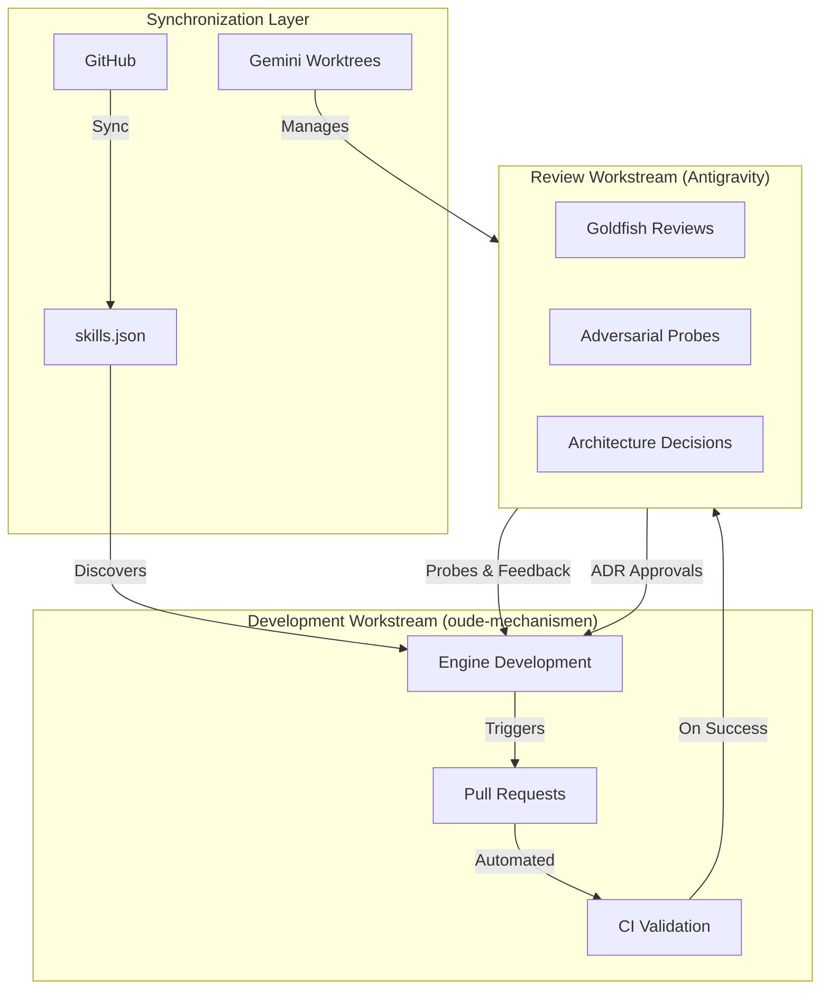

# Development & Review Pairing: Oude Mechanismen ↔ Antigravity

**Document ID:** `docs/REVIEW_PAIRING.md`  
**Status:** Active  
**Author:** Vibe Code (Pair Programming Setup)  
**Date:** 2026-11-12  

---

## 1. Overview

This document establishes a **bidirectional pairing workflow** between development on `oude-mechanismen` and reviews conducted using **Gemini Antigravity** (Google's AI coding assistant). The pairing ensures that:

- All engine changes are reviewed through Antigravity's adversarial probing and goldfish review processes
- Review feedback directly informs development priorities and architectural decisions
- The two workstreams remain synchronized without manual overhead

---

## 2. Architectural Context

### 2.1 Antigravity Integration Points

`oude-mechanismen` is already integrated with **Gemini Antigravity** through:

1. **Global Skills Mounting:** `~/.gemini/config/skills.json` points to `~/Repos/oude-mechanismen/skills`
2. **ADR Co-Authorship:** ADR 001 and ADR 002 were co-authored by Antigravity
3. **Review Process:** Existing Goldfish Review protocol (see `docs/reviews/001_archival_scriptorium_review.md`)

### 2.2 Workflow Topology



---

## 3. Pairing Modes

### 3.1 Mode A: Development → Review (Push Model)

Engine changes trigger automated review requests in Antigravity.

**Trigger Conditions:**
- New ADR documents merged to `main`
- Major architectural changes (breaking changes, new layers)
- New skills added to `skills/`
- Changes to core scripts (`scripts/*.py`)

**Workflow:**
1. Developer commits changes with `[REVIEW-REQUESTED]` in commit message
2. CI validates changes and creates a worktree in Antigravity
3. Antigravity performs Goldfish Review with adversarial probes
4. Review report is posted as PR comment or in `docs/reviews/`
5. Developer addresses feedback and iterates

### 3.2 Mode B: Review → Development (Pull Model)

Antigravity-initiated reviews drive development priorities.

**Trigger Conditions:**
- Campaign vaults report friction (logged in `TASKS.md`)
- New requirements from downstream vaults (`hostile`, `charged`)
- Architectural gaps identified in existing ADRs

**Workflow:**
1. Antigravity identifies issue and creates adversarial probes
2. Probes are documented in `docs/adr/` or `docs/designs/`
3. Developer implements resolution based on probe findings
4. Implementation is validated against probes
5. ADR is updated with resolution status

### 3.3 Mode C: Bidirectional Sync (Continuous Pairing)

Active development sessions with Antigravity co-pilot.

**Setup:**
```bash
# Mount engine skills in Antigravity
mkdir -p ~/.gemini/config
cat > ~/.gemini/config/skills.json << 'EOF'
{
  "entries": [
    {"path": "~/Repos/oude-mechanismen/skills"},
    {"path": "~/Repos/artifice/skills"}
  ]
}
EOF

# Create worktree for active development
gemini worktree add oude-mechanismen ~/Repos/oude-mechanismen
```

**Workflow:**
1. Developer and Antigravity work in shared worktree
2. Changes are committed with co-authorship: `Co-authored-by: Antigravity <antigravity@gemini.google.com>`
3. Continuous validation through Antigravity's local model checks
4. Periodic sync to `main` with review gates

---

## 4. Review Process Specification

### 4.1 Goldfish Review Protocol

The **Goldfish Review** is a zero-context adversarial review process designed to catch:
- Logic contradictions
- Unbounded types or state desynchronisation
- Path resolution hazards
- Privacy air-gap violations
- Canon hierarchy violations

**Process:**
1. **Isolation:** Reviewer (Antigravity) has zero prior context about the change
2. **Probing:** Systematically test invariants through adversarial probes
3. **Documentation:** All probes and resolutions are documented in `docs/reviews/`
4. **Approval:** Change is approved only when all probes are resolved

**Template:**
```markdown
# Goldfish Review: <Component Name>

**Review Target:** <file or component under review>
**Reviewer:** Zero-Context Goldfish Reviewer Agent
**Date:** YYYY-MM-DD
**Verdict:** Approved / Needs Revision / Rejected

---

## Executive Summary

<One paragraph summary of findings>

---

## Adversarial Probes

| ID | Area | Invariant Probed | Status |
| :--- | :--- | :--- | :--- |
| PROBE-01 | <Component> | <Failure mode> | Resolved / Open |

---

## Detailed Findings

### <Section>

* **<Issue>:** <Description>
* **Resolution:** <How it was addressed>
* **Verification:** <How resolution was validated>
```

### 4.2 Adversarial Probe Categories

| Category | Focus Area | Example Probes |
| :--- | :--- | :--- |
| **State Mutation** | Front-matter, path resolution | Path calculation breaks Jekyll catalog indexing |
| **Template Integration** | Liquid includes, HTML rendering | Markdown syntax in HTML-only contexts |
| **Invariant Check** | Licensing, anti-AI verification | Exact string matching rejects valid CC0 licenses |
| **Network & Performance** | API calls, rate limiting | Unbounded sequential requests cause rate-limit hits |
| **Repository Architecture** | File distribution, sync logic | Missing runner templates cause downstream drift |
| **API Governance** | External service compliance | Missing User-Agent headers violate API policies |
| **Workspace Hygiene** | Temporary files, Git cleanliness | Temp files dirty Git trees, missing .gitignore |
| **Resolution & Testability** | Image processing, unit tests | Missing resolution bounds, non-deterministic functions |

---

## 5. Automation Infrastructure

### 5.1 GitHub Workflows

#### Review Request Workflow (`.github/workflows/review-request.yml`)

```yaml
name: Request Antigravity Review

on:
  pull_request:
    types: [opened, synchronize, ready_for_review]
    branches: [main, before-publish]
  push:
    branches: [main]
    paths:
      - 'docs/adr/**'
      - 'docs/designs/**'
      - 'skills/**'
      - 'scripts/**'

jobs:
  request-review:
    if: contains(github.event.head_commit.message, '[REVIEW-REQUESTED]') || 
        contains(github.event.pull_request.title, '[REVIEW-REQUESTED]')
    runs-on: ubuntu-latest
    steps:
      - name: Checkout repository
        uses: actions/checkout@v4
        with:
          fetch-depth: 0

      - name: Create review worktree in Antigravity
        run: |
          # This is a placeholder for the actual Antigravity worktree creation
          # In practice, this would use Gemini API or a dedicated action
          echo "Triggering Antigravity review for ${{ github.ref }}"
          echo "Worktree: oude-mechanismen/${{ github.ref_name }}"
          
      - name: Post review request comment
        uses: actions/github-script@v7
        with:
          script: |
            github.rest.issues.createComment({
              issue_number: context.issue.number,
              owner: context.repo.owner,
              repo: context.repo.repo,
              body: `🔍 **Antigravity Review Requested**

This change has been queued for Goldfish Review in Antigravity.

- **Worktree:** "` + process.env.GITHUB_REF_NAME + `"`
- **Scope:** ${{
    contains(github.event.head_commit.message, '[FULL-REVIEW]') && 'Full Goldfish Review' || 
    contains(github.event.head_commit.message, '[ADR-REVIEW]') && 'ADR Review' || 
    'Standard Review'
  }}
- **Probes:** Automated adversarial probes will be executed

Review report will be posted here once complete.`
            })
```

#### Review Validation Workflow (`.github/workflows/review-validate.yml`)

```yaml
name: Validate Review Compliance

on:
  pull_request:
    types: [closed]

jobs:
  validate-review:
    if: github.event.pull_request.merged == true
    runs-on: ubuntu-latest
    steps:
      - name: Checkout repository
        uses: actions/checkout@v4

      - name: Check for review approval
        run: |
          # Verify that changes have been reviewed
          if [[ "${{ github.event.pull_request.title }}" == *"[REVIEW-REQUESTED]"* ]]; then
            # Check if review document exists
            if [[ ! -f "docs/reviews/pr_${{ github.event.pull_request.number }}_review.md" ]]; then
              echo "::error::No review document found for this PR"
              exit 1
            fi
            
            # Check if all probes are resolved
            if grep -q "Status.*Open" "docs/reviews/pr_${{ github.event.pull_request.number }}_review.md"; then
              echo "::error::Unresolved probes found in review"
              exit 1
            fi
          fi

      - name: Update catalog with review metadata
        run: |
          # Update catalog.json with review information
          python3 - << 'PY'
          import json
          from datetime import datetime
          
          # Load catalog
          try:
            with open('.agents/context/catalog.json', 'r') as f:
              catalog = json.load(f)
          except FileNotFoundError:
            catalog = {"entries": [], "reviews": []}
          
          # Add review metadata
          review_entry = {
            "pr_number": ${{ github.event.pull_request.number }},
            "pr_title": ${{ github.event.pull_request.title }},
            "review_date": datetime.utcnow().isoformat(),
            "reviewer": "Antigravity",
            "status": "approved",
            "probes_count": 0  # Would be populated from review doc
          }
          
          catalog.setdefault("reviews", []).append(review_entry)
          
          with open('.agents/context/catalog.json', 'w') as f:
            json.dump(catalog, f, indent=2)
          PY
```

### 5.2 Local Development Hooks

#### Pre-Commit Hook for Review Requests

```bash
#!/usr/bin/env bash
# .githooks/pre-commit (or use git config core.hooksPath)

# Check if commit message contains review request
if grep -q "\[REVIEW-REQUESTED\]" "$1"; then
  echo "🔍 Review request detected in commit message"
  
  # Validate that this is an appropriate change for review
  CHANGED_FILES=$(git diff --cached --name-only --diff-filter=ACM)
  
  REVIEWABLE_CHANGES=$(echo "$CHANGED_FILES" | grep -E '(docs/adr/|docs/designs/|skills/|scripts/|src/)')
  
  if [ -z "$REVIEWABLE_CHANGES" ]; then
    echo "::error::[REVIEW-REQUESTED] tag used but no reviewable changes detected"
    echo "Reviewable paths: docs/adr/, docs/designs/, skills/, scripts/, src/"
    exit 1
  fi
  
  echo "✓ Review request validated for: $REVIEWABLE_CHANGES"
fi
```

#### Post-Merge Hook for Review Documentation

```bash
#!/usr/bin/env bash
# .githooks/post-merge

# Check if merged branch had review requests
MERGED_COMMITS=$(git log --oneline --first-parent $2..HEAD)

if echo "$MERGED_COMMITS" | grep -q "\[REVIEW-REQUESTED\]"; then
  echo "📝 Creating review documentation stub..."
  
  # Create a review stub document
  PR_NUMBER=$(echo "$MERGED_COMMITS" | grep -oE '#[0-9]+' | head -1 | tr -d '#')
  REVIEW_DATE=$(date +%Y-%m-%d)
  
  cat > "docs/reviews/pr_${PR_NUMBER}_review.md" << EOF
# Goldfish Review: PR #${PR_NUMBER}

**Review Target:** PR #${PR_NUMBER}  
**Reviewer:** Antigravity (TBD)  
**Date:** ${REVIEW_DATE}  
**Verdict:** Pending  

---

## Executive Summary

<TBD - To be completed by Antigravity review>

---

## Adversarial Probes

| ID | Area | Invariant Probed | Status |
| :--- | :--- | :--- | :--- |

---

## Detailed Findings

<TBD>
EOF
  
  git add "docs/reviews/pr_${PR_NUMBER}_review.md"
  echo "✓ Review stub created: docs/reviews/pr_${PR_NUMBER}_review.md"
fi
```

---

## 6. Development Guidelines for Antigravity Pairing

### 6.1 Commit Message Conventions

| Tag | Purpose | Example |
| :--- | :--- | :--- |
| `[REVIEW-REQUESTED]` | Request full Goldfish Review | `feat: add new skill [REVIEW-REQUESTED]` |
| `[ADR-REVIEW]` | Request ADR-specific review | `docs: ADR 003 draft [ADR-REVIEW]` |
| `[FULL-REVIEW]` | Request comprehensive review with all probes | `refactor: core architecture [FULL-REVIEW]` |
| `[PROBE-nn]` | Reference specific probe | `fix: resolve PROBE-01 path calculation` |
| `[CO-AUTHORED]` | Co-authored with Antigravity | `feat: new feature [CO-AUTHORED]` |

### 6.2 File Naming Conventions

**Review Documents:**
- `docs/reviews/<component>_review.md` - Component-specific reviews
- `docs/reviews/pr_<number>_review.md` - PR-specific reviews
- `docs/reviews/adr_<number>_review.md` - ADR-specific reviews

**Design Documents:**
- `docs/designs/<number>_<name>.md` - Design specifications
- `docs/adr/<number>_<name>.md` - Architecture Decision Records

### 6.3 Co-Authorship Attribution

When changes are co-authored with Antigravity, use the standard Git co-authorship trailer:

```
Co-authored-by: Antigravity <antigravity@gemini.google.com>
```

This ensures proper attribution in Git history and GitHub's contribution graph.

---

## 7. Quality Gates

### 7.1 Pre-Review Checklist

Before requesting a review, ensure:

- [ ] All CI checks pass
- [ ] Code follows repository style (British English, blank lines after headings)
- [ ] No hardcoded setting-specific lore or house rules
- [ ] All new skills have proper `SKILL.md` with YAML front matter
- [ ] Changes are backward compatible (or version bumped appropriately)
- [ ] Documentation is updated (README, AGENTS.md, etc.)
- [ ] Review document stub is created (if applicable)

### 7.2 Review Completion Criteria

A review is considered complete when:

- [ ] All adversarial probes are resolved
- [ ] Goldfish Review verdict is "Approved"
- [ ] Review document is committed to `docs/reviews/`
- [ ] Any required changes are implemented
- [ ] Catalog.json is updated with review metadata
- [ ] CHANGELOG.md is updated with review-related changes

### 7.3 Post-Review Actions

After a successful review:

1. **Merge the PR** with review approval
2. **Tag the release** if this was a major change
3. **Update downstream vaults** via `sync.sh` or `bundle update`
4. **Announce** the change in campaign channels
5. **Archive** the review worktree in Antigravity

---

## 8. Troubleshooting

### 8.1 Common Issues

**Issue: Antigravity not discovering skills**

```bash
# Verify skills.json configuration
cat ~/.gemini/config/skills.json

# Ensure path is correct
ls -la ~/Repos/oude-mechanismen/skills

# Restart Antigravity to reload configuration
```

**Issue: Review workflow not triggering**

```bash
# Check GitHub Actions logs
gh run list --repo terra-campaigns/oude-mechanismen

# Verify commit message has correct tag
git log --oneline -1

# Check workflow file syntax
python3 -c "import yaml; yaml.safe_load(open('.github/workflows/review-request.yml'))"
```

**Issue: Worktree conflicts**

```bash
# List existing worktrees
gemini worktree list

# Remove conflicting worktree
gemini worktree remove oude-mechanismen/conflicting-branch

# Recreate worktree
gemini worktree add oude-mechanismen/main ~/Repos/oude-mechanismen
```

### 8.2 Debugging Probes

When a probe fails, use this debugging approach:

1. **Reproduce the issue:**
   ```bash
   # Run the specific test or validation
   python3 -m pytest tests/test_<component>.py -v
   ```

2. **Isolate the invariant:**
   ```bash
   # Create a minimal test case
   python3 - << 'PY'
   # Reproduce the exact scenario from the probe
   PY
   ```

3. **Verify the fix:**
   ```bash
   # Run the probe again
   # Check that it now passes
   ```

4. **Document the resolution:**
   ```markdown
   | PROBE-nn | <Component> | <Issue> | **Resolved** |
   ```

---

## 9. Reference: Existing Reviews

- **[Goldfish Review: The Archival Scriptorium](docs/reviews/001_archival_scriptorium_review.md)** - Example of a complete Goldfish Review with 11 probes
- **[ADR 001: Dynamic Engine vs Sync Distribution](docs/adr/001_dynamic_engine_vs_sync_distribution.md)** - Co-authored by Antigravity
- **[ADR 002: Python CLI Distribution via uv](docs/adr/002_python_cli_distribution_uv.md)** - Co-authored by Antigravity

---

## 10. Quick Start

### 10.1 For Developers

1. **Set up Antigravity pairing:**
   ```bash
   # Ensure skills are mounted
   mkdir -p ~/.gemini/config
   cat > ~/.gemini/config/skills.json << 'EOF'
   {
     "entries": [
       {"path": "~/Repos/oude-mechanismen/skills"}
     ]
   }
   EOF
   ```

2. **Request a review:**
   ```bash
   git commit -m "feat: new skill [REVIEW-REQUESTED]"
   git push
   ```

3. **Address feedback:**
   - Review Antigravity's probes
   - Implement fixes
   - Commit with probe references: `fix: resolve PROBE-01`

### 10.2 For Reviewers (Antigravity)

1. **Discover the repository:**
   ```bash
   gemini worktree add oude-mechanismen ~/Repos/oude-mechanismen
   ```

2. **Run Goldfish Review:**
   - Open the target file or PR
   - Execute adversarial probes
   - Document findings in `docs/reviews/`

3. **Approve or request changes:**
   - Set verdict to "Approved" or "Needs Revision"
   - List unresolved probes
   - Post review as PR comment

---

## Appendix A: Probe Templates

### Template: State Mutation Probe

```markdown
| PROBE-nn | State Mutation / <Component> | <Specific failure mode> | **Status** |
| :--- | :--- | :--- | :--- |

**Failure Mode:** <Detailed description of what could go wrong>

**Test Case:**
```python
# Code to reproduce the issue
```

**Expected Behavior:** <What should happen>

**Actual Behavior:** <What currently happens>

**Resolution:** <How to fix it>

**Verification:**
```python
# Code to verify the fix
```
```

### Template: Invariant Check Probe

```markdown
| PROBE-nn | Invariant Check / <Component> | <Specific invariant> | **Status** |

**Invariant:** <The rule that must always hold>

**Test Input:** <Input that might violate the invariant>

**Violation:** <How the invariant is violated>

**Resolution:** <How to enforce the invariant>

**Verification:** <How to confirm the invariant now holds>
```

---

## Appendix B: Review Metrics

Track these metrics to ensure review quality:

| Metric | Target | Current |
| :--- | :--- | :--- |
| Average probes per review | 5-10 | TBD |
| Average resolution time | < 24 hours | TBD |
| Probe resolution rate | > 95% | TBD |
| Reviews per major change | 100% | TBD |

---

*This document is a living specification. Updates should be made through the same review process it describes.*
