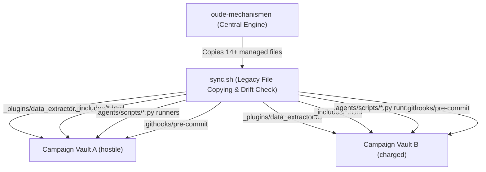
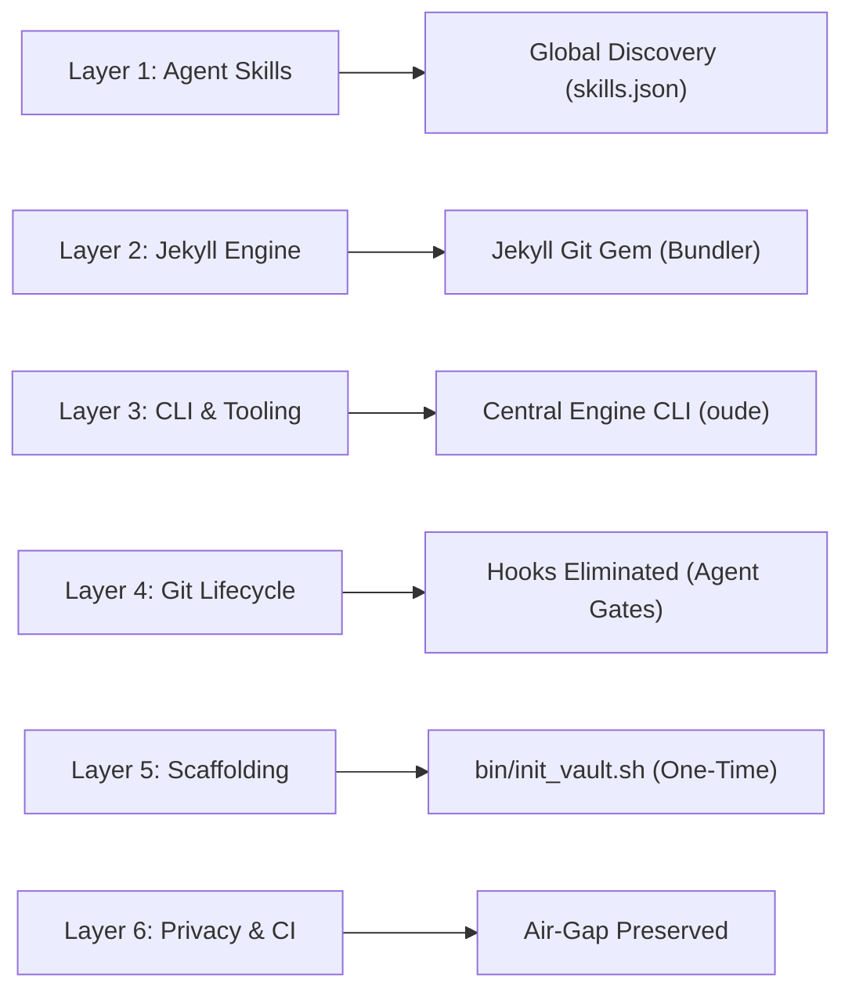
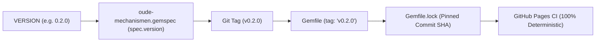
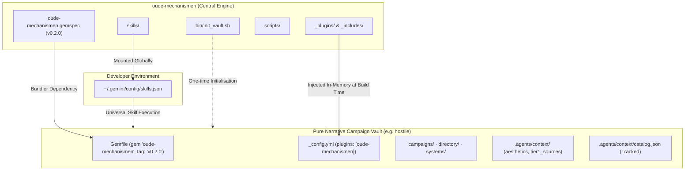

# ADR 001: Architectural Evaluation — Dynamic Engine Usage vs Sync-Based Distribution

- **Status:** Accepted
- **Date:** 2026-11-07
- **Author:** Antigravity (Pair Programming with Estevão Alvarenga)
- **Component:** `oude-mechanismen.gemspec`, `bin/init_vault.sh`, `jekyll/_plugins/`, `skills/`, `scripts/`, `templates/`
- **Origin:** Operational friction logged from `hostile` (Session 003)

---

## 1. Context & Problem Statement

`oude-mechanismen` was extracted as the shared procedural engine, static site tooling, and agent skills library for tabletop RPG campaign vaults (e.g. `hostile`, `charged`). In its initial design, it adopted the file-synchronisation architecture inherited from `arete` and `arete-engine`:



### Observed Operational Friction

While this sync-based distribution ensured each downstream campaign repository was self-contained for standalone compilation, continuous maintenance across live campaigns revealed four critical bottlenecks:

1. **Repetitive Maintenance Overhead:** Any bug fix, enhancement, or performance improvement in `_plugins/data_extractor.rb`, Liquid includes, or runner scripts required running `./sync.sh --force` across every downstream repository, committing duplicate diffs, and submitting separate Pull Requests per vault.
2. **Drift & Silent Divergence Risk:** If a downstream campaign vault customised or accidentally edited a managed file locally, `sync.sh` flagged a dirty drift. Resolving this required manual diffing or destructive `--force` overwrites.
3. **Repository Clutter & Cognitive Noise:** Downstream campaign vaults accumulated duplicate copies of engine plumbing (`_plugins/`, `_includes/`, `.agents/scripts/`, `bin/setup`, `all-content.md`, `requirements.txt`, `.githooks/`). Campaign repositories should focus purely on narrative canon (Tier 1 markdown wiki notes) and campaign configuration (`aesthetics.yml`, `tier1_sources.yml`).
4. **Git Pre-Commit Hook Fragility:** The legacy `.githooks/pre-commit` hook attempted to run `_plugins/data_extractor.rb` and mutate Git staging (`git add`) on every markdown commit. This required manual `git config core.hooksPath` setup, broke when files were moved, and interfered with standard editing workflows in Obsidian and GUI Git clients.
5. **Contrast with the `artifice` Dynamic Model:** In the sibling repository `artifice`, capabilities, agents, and skills are mounted globally via `~/.gemini/config/skills.json` and executed directly from `ARTIFICE_ROOT`. There is zero file copying, zero drift, and immediate propagation of improvements across the entire developer ecosystem.

---

## 2. Multi-Layer Feasibility Analysis

To transition `oude-mechanismen` to a modern, decoupled architecture without sacrificing standalone builds or privacy boundaries, we evaluated the six discrete layers of the engine:



### Layer 1: Agent Skills & Personas (`skills/`)

- **Resolution:** Mount `~/Repos/oude-mechanismen/skills` globally inside `~/.gemini/config/skills.json` alongside `artifice/skills`.
- **Result:** Downstream campaign vaults no longer require `.agents/skills.json` or `.agents/skills/`. All agent skills (`scribe-session`, `prep-session`, `add-chapter`, `lint-wiki`, `illustrate-entry`) become universally accessible.

### Layer 2: Jekyll Static Engine (`_plugins/`, `_includes/`, `all-content.md`)

- **Resolution:** Package `oude-mechanismen` as a standard Jekyll plugin gem via `oude-mechanismen.gemspec`.
- **Result:** Downstream vaults declare a single Bundler dependency in `Gemfile`:
  ```ruby
  gem "oude-mechanismen", git: "https://github.com/terra-campaigns/oude-mechanismen.git", tag: "v0.2.0"
  ```
  And declare the plugin in `_config.yml`:
  ```yaml
  plugins:
    - oude-mechanismen
  ```
  All Ruby plugins (`data_extractor.rb`, `llm_content.rb`) and shared Liquid templates (`_includes/`) are injected in-memory at build time. In GitHub Actions (`pages.yml`), `ruby/setup-ruby` automatically caches and executes the gem during `bundle install`.

### Layer 3: Procedural Scripts & CLI Runners (`scripts/`, `runners/`)

- **Resolution:** Centralise script execution. Procedural agent skills invoke core engine scripts directly from the engine checkout (`$OUDE_MECHANISMEN_DIR/scripts/` or sibling repository resolution).
- **Result:** Delete all boilerplate runner scripts (`.agents/scripts/*.py`) from downstream vaults.

### Layer 4: Git Lifecycle & Hook Elimination (`.githooks/`)

- **Resolution:** **Eliminate Git pre-commit hooks entirely.**
- **Rationale:** 
  - Intercepting commits via `.githooks/pre-commit` to re-extract `catalog.json` caused unwanted staging mutations, required non-standard `core.hooksPath` configuration, and failed when `data_extractor.rb` was removed from the vault tree.
  - Instead, catalogue freshness is guaranteed through three explicit, non-intrusive mechanisms:
    1. **Agent Task Completion:** Procedural skills (`add-chapter`, `add-character`, `scribe-session`) autonomously regenerate `catalog.json` as the final step of their task.
    2. **Just-in-Time Retrieval Refresh:** If `lookup-context` detects that `catalog.json` is missing or older than the latest `.md` note, it triggers an on-the-fly refresh.
    3. **Pre-Publishing Gate (Gate 3):** The mandatory pre-publishing audit verifies that `catalog.json` is 100% current before declaring a branch or session ready to merge.
  - Human GM commits in Obsidian and VS Code remain fast, standard, and completely side-effect-free.

### Layer 5: Scaffolding & Initialisation (`bin/init_vault.sh`)

- **Resolution:** Retire `sync.sh` and continuous file synchronisation. Replace with a dedicated, one-time campaign initialisation bootstrapper: `bin/init_vault.sh`.
- **Contract:**
  - `bin/init_vault.sh <target_vault>` is executed **once** when onboarding a new or existing campaign.
  - It creates standard directory topology (`campaigns/`, `directory/`, `systems/`, `imgs/gallery/`, `imgs/badges/`).
  - It scaffolds starter configuration files (`aesthetics.yml`, `tier1_sources.yml`, `decisions.md`, `_config.yml`, `Gemfile`).
  - Once initialised, these files belong exclusively to the campaign vault. The engine will never overwrite or "sync" them again.

### Layer 6: CI/CD & Three-Tier Storage Privacy Air-Gap

- **Resolution:** Full preservation of the Three-Tier Canon Hierarchy:
  - **Tier 0:** Raw audio and verbatim transcripts remain strictly local at `~/Private/rpg-sessions/<campaign>/`.
  - **Tier 2:** De-personalised session notes, tactical facts, textures, and prep remain in Google Drive `_sessions/`.
  - **Tier 1:** Canonical markdown wiki notes live in the Git repository.
- In headless CI (`pages.yml`), Bundler fetches only public engine code from GitHub with zero access or risk to private session assets.

---

## 3. Strict Versioning & Deterministic Build Policy

To prevent version mismatches, drift, or surprise build failures during campaign prep, the architecture implements a strict four-point versioning policy:



1. **Single Source of Truth (`VERSION` file):**
   - The engine's root `VERSION` file dictates the package semver.
   - `oude-mechanismen.gemspec` dynamically reads this file:
     ```ruby
     spec.version = File.read(File.expand_path("VERSION", __dir__)).strip
     ```
2. **Deterministic Semver Pinning in Downstream Vaults:**
   - Downstream `Gemfile` templates pin the released tag rather than tracking `main` blindly:
     ```ruby
     gem "oude-mechanismen", git: "https://github.com/terra-campaigns/oude-mechanismen.git", tag: "v0.2.0"
     ```
3. **Immutable CI Builds via `Gemfile.lock`:**
   - When `bundle install` is run, Bundler generates `Gemfile.lock`, recording the exact Git commit SHA.
   - GitHub Actions `pages.yml` strictly honours `Gemfile.lock`. Cloud builds will never pull an untested upstream engine commit.
   - Engine updates in a vault are deliberate and explicit via:
     ```bash
     bundle update oude-mechanismen
     ```
4. **Runtime Version Auditing in `catalog.json`:**
   - `data_extractor.rb` stamps the engine version directly into `.agents/context/catalog.json`:
     ```json
     {
       "generated": "2026-11-07 22:35:00 UTC",
       "engine_version": "0.2.0",
       "tier": 1,
       "total_entries": 42
     }
     ```
   - Agent skills inspect this key during reconnaissance and alert the GM if a vault is running an outdated engine version.

---

## 4. Decision: Adopt Option 2 (Hybrid Decoupled Architecture)

We formally adopt the **Hybrid Decoupled Architecture**:



---

## 5. Downstream Campaign Vault: Before vs After

| Dimension | Legacy Model (`sync.sh` + Hooks) | Modern Decoupled Model (Option 2) |
| :--- | :--- | :--- |
| **Ruby Plugins** | Copied `_plugins/data_extractor.rb`, `llm_content.rb` | **None** (provided in-memory by gem) |
| **Liquid Includes** | Copied `_includes/connected_to.html`, `image_gallery.html`, etc. | **None** (provided by gem) |
| **Runner Scripts** | Copied `.agents/scripts/*.py` boilerplate | **None** (skills call engine scripts directly) |
| **Git Hooks** | `.githooks/pre-commit` (requires `git config core.hooksPath`) | **None** (clean, standard Git commits) |
| **Skills Config** | Duplicate `.agents/skills.json` per vault | **None** (mounted globally in `~/.gemini/config/skills.json`) |
| **Scaffolding Tool** | `sync.sh --init` (coupled with continuous sync) | `bin/init_vault.sh` (pure one-time bootstrapper) |
| **Engine Updates** | Run `./sync.sh --force`, resolve drift, commit PRs | Run `bundle update oude-mechanismen` |
| **CI Build Health** | Vulnerable to local drift | 100% deterministic via `Gemfile.lock` |

---

## 6. Implementation & Migration Roadmap

### Phase 1: Engine Gem Packaging & Global Discovery (Sprint 1)

1. **Author `oude-mechanismen.gemspec`:**
   - Configure gem metadata, dependencies (`jekyll >= 4.0`), and file manifests.
   - Point `spec.version` to root `VERSION`.
2. **Gem Structure Alignment:**
   - Ensure `lib/oude-mechanismen.rb` (or `lib/oude_mechanismen.rb`) loads plugins and registers includes path with Jekyll.
   - Stamp `"engine_version"` into `catalog.json` generation logic.
3. **Global Antigravity Discovery:**
   - Mount `/Users/efsa/Repos/oude-mechanismen/skills` into `~/.gemini/config/skills.json`.
4. **Bootstrapper Authoring:**
   - Create `bin/init_vault.sh` based on `templates/` and `sync.sh --init` logic.
   - Deprecate continuous file-sync flags in `sync.sh`.

### Phase 2: Pilot Migration on `hostile` (Sprint 2)

1. **Gemfile Update:**
   - Add `gem "oude-mechanismen", git: "https://github.com/terra-campaigns/oude-mechanismen.git", tag: "v0.2.0"` (with local Bundler path override for local dev).
2. **Purge Copied Engine Plumbing:**
   - Remove `_plugins/data_extractor.rb`, `_plugins/llm_content.rb`, `_includes/` (engine ones), `.agents/scripts/`, `.agents/skills.json`, and `.githooks/`.
3. **Validation Gate:**
   - Run `bundle install` and `bundle exec jekyll build` locally.
   - Push to feature branch and verify GitHub Pages CI (`pages.yml`).
   - Confirm `catalog.json` generation and clean git commit workflow.

### Phase 3: Upstream Finalisation & Deprecation (Sprint 3)

1. Update `templates/` to generate decoupled starter files.
2. Formally replace `sync.sh` with `bin/init_vault.sh`.
3. Update `AGENTS.md` and `README.md` to document the modern decoupled architecture.
