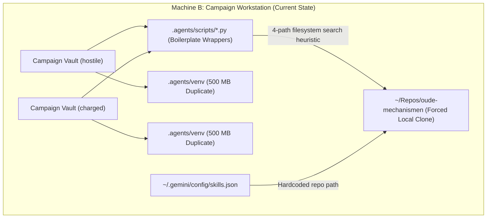
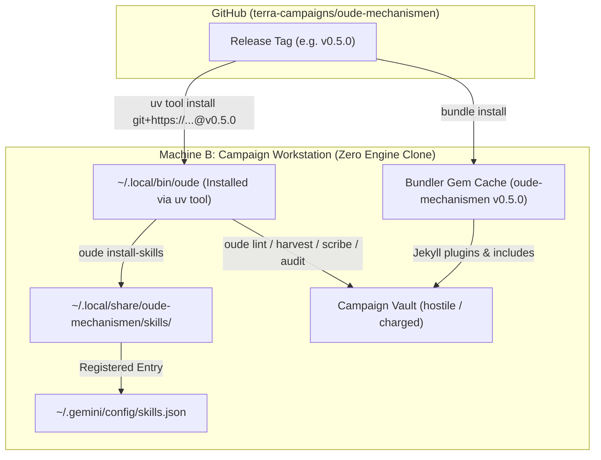

# ADR 002: Cross-Vault Python Tooling & Zero-Clone CLI Distribution via Astral `uv`

- **Status:** Proposed
- **Date:** 2026-11-10
- **Author:** Antigravity (Pair Programming with Estevão Alvarenga)
- **Component:** `pyproject.toml`, `src/oude_mechanismen/`, `scripts/`, `skills/`, `templates/runners/`, `bin/`
- **Origin:** Multi-workstation decoupling architecture following [ADR 001](001_dynamic_engine_vs_sync_distribution.md)

---

## 1. Context & Problem Statement

In [ADR 001](001_dynamic_engine_vs_sync_distribution.md) (delivered in `v0.4.0` and `v0.4.1`), `oude-mechanismen` decoupled its **Jekyll static site engine** (Layer 2) by packaging `_plugins/` and `_includes/` as a Git-backed RubyGem (`gem "oude-mechanismen", tag: "v0.4.1"`). Downstream campaign vaults (`hostile`, `charged`) can now compile their static sites and Tier 1 catalogues (`catalog.json`) in CI and locally without copying Ruby plugins or Liquid includes.

However, operating across a **two-machine topology**—where `oude-mechanismen` is developed on an engineering workstation (Machine A) and campaign vaults (`hostile`, `charged`) are operated on a tabletop/GM workstation (Machine B)—exposed two remaining anchors that still force Machine B to maintain a local Git clone of `oude-mechanismen`:



### Observed Operational Friction

1. **Forced Local Repository Clone on Consumer Workstations:**
   - Even though a GM workstation never edits engine code, it cannot delete `~/Repos/oude-mechanismen`.
   - Agent skills are mounted via `~/.gemini/config/skills.json` pointing to `~/Repos/oude-mechanismen/skills`.
   - Procedural scripts (`lint_chapter.py`, `harvest_archival.py`, `scribe_session.py`, `transcribe_session.py`) are invoked via relative or sibling filesystem paths.
2. **Python Environment Fragmentation (`.agents/venv`):**
   - `templates/bin/setup.template` creates a dedicated `.agents/venv` inside every campaign vault and runs `pip install -r .agents/requirements.txt` (`pyyaml`, `pypdf`, `numpy`, `Pillow`).
   - This duplicates ~500 MB of libraries per campaign vault and breaks silently whenever the host operating system upgrades its system Python (e.g. Homebrew Python minor version bumps).
3. **Runner Wrapper Sprawl & Drift (`templates/runners/*.py.template`):**
   - Every engine script requires a 50-line proxy script in `templates/runners/` containing identical `find_core_script()` boilerplate that probes four filesystem locations (`$OUDE_MECHANISMEN_DIR`, `../oude-mechanismen`, `~/Repos/oude-mechanismen`, `.engine/`).
   - When `scripts/scribe_session.py` was added in `v0.2.0`, omitting its runner template caused downstream drift in `charged` (logged in `TASKS.md`).
4. **Cross-Directory Import Fragility:**
   - `art_filter.py` resides inside `skills/illustrate-entry/scripts/art_filter.py`, forcing `scripts/harvest_archival.py` to use `importlib.util.spec_from_file_location` path gymnastics to import it.
5. **Contrast with `arete-engine` and `artifice`:**
   - The sibling repository `arete-engine` packages its Python scripts and templates into a single `hatchling` wheel with a unified CLI entrypoint (`arete`), installable globally via Astral `uv tool`.

---

## 2. Architectural Evaluation & Options

We evaluated three options for distributing Python tooling and agent skills across workstations:

| Criterion | Option 1: Legacy Runners + Per-Vault `.venv` | Option 2: Standalone PEP 723 Scripts (`uv run`) | Option 3: Packaged `oude` CLI (`uv tool`) + XDG Skills Sync |
| :--- | :--- | :--- | :--- |
| **Local Engine Clone Required?** | Yes (`~/Repos/oude-mechanismen`) | Yes (to hold `.py` scripts & `skills/`) | **No (100% Zero-Clone on Consumer Machines)** |
| **Per-Vault `.agents/venv`?** | Yes (~500 MB per vault) | No (cached by `uv`) | **No (single isolated `uv` tool environment)** |
| **Runner Scripts in Vaults?** | Yes (`.agents/scripts/*.py`) | No | **No (all `.agents/scripts/*.py` deleted)** |
| **Invocation Ergonomics** | `python3 .agents/scripts/lint_chapter.py` | `uv run /path/to/scripts/lint_chapter.py` | **`oude lint` (location-independent)** |
| **Version Pinning** | Unpinned / manual `git pull` | Manual `git pull` | **Semver Git tag (`@v0.5.0`)** |

### Decision: Adopt Option 3 (Unified `oude` CLI via `uv tool` + XDG Skills Sync)

We adopt **Option 3**, supplemented by PEP 723 inline metadata headers on individual scripts for local engine development.



---

## 3. Detailed Technical Specification

### 3.1 Package Topology & Single-Source Versioning (`pyproject.toml`)

Following **Occam's Razor**, we avoid moving existing `scripts/*.py` files or breaking the 58 existing unit tests (`tests/test_*.py`). Instead, we introduce a minimal `src/oude_mechanismen/` package (`__init__.py` and `cli.py`) and use `hatchling`'s `force-include` mechanism to bundle `scripts/`, `skills/`, `templates/`, and `VERSION` directly into the wheel:

```text
oude-mechanismen/
├── VERSION                         # Single source of truth for both Gem & Python package
├── oude-mechanismen.gemspec        # Reads VERSION (Jekyll RubyGem)
├── pyproject.toml                  # Reads VERSION (Python Package & CLI)
├── src/
│   └── oude_mechanismen/
│       ├── __init__.py             # Dynamically exposes __version__ from VERSION
│       └── cli.py                  # Unified `oude` CLI dispatcher (< 200 lines)
├── scripts/                        # Unmoved; bundled into wheel via force-include
│   ├── art_filter.py               # Consolidated from skills/illustrate-entry/scripts/
│   ├── audit_coverage.py
│   ├── benchmark_models.py
│   ├── generate_digests.py
│   ├── harvest_archival.py
│   ├── lint_chapter.py
│   ├── scribe_session.py
│   └── transcribe_session.py
├── skills/                         # Bundled into wheel for `oude install-skills`
└── templates/                      # Bundled into wheel for `oude init`
```

#### `pyproject.toml` Specification

```toml
[build-system]
requires = ["hatchling"]
build-backend = "hatchling.build"

[project]
name = "oude-mechanismen"
dynamic = ["version"]
description = "Shared procedural engine, archival scriptorium, and CLI tooling for tabletop RPG campaign vaults."
readme = "README.md"
requires-python = ">=3.11"
license = { file = "LICENSE" }
dependencies = [
    "pypdf>=6.0.0",
    "pyyaml>=6.0.0",
    "numpy>=1.24.0",
    "Pillow>=10.0.0",
]

[project.optional-dependencies]
dev = [
    "pytest>=8.0.0",
    "ruff>=0.4.0",
]

[project.scripts]
oude = "oude_mechanismen.cli:main"

[tool.hatch.version]
path = "VERSION"
pattern = "(?P<version>\\d+\\.\\d+\\.\\d+)"

[tool.hatch.build.targets.wheel]
packages = ["src/oude_mechanismen"]

[tool.hatch.build.targets.wheel.force-include]
"VERSION" = "oude_mechanismen/VERSION"
"scripts" = "oude_mechanismen/scripts"
"skills" = "oude_mechanismen/skills"
"templates" = "oude_mechanismen/templates"
"jekyll/all-content.md" = "oude_mechanismen/jekyll/all-content.md"
```

#### Dual-Mode Asset Resolution (`_resolve_asset_dir`)

Just as in `arete-engine`, `src/oude_mechanismen/cli.py` resolves bundled directories seamlessly whether running from an installed wheel (`uv tool install`) or an editable Git checkout (`uv tool install --editable .`):

```python
PACKAGE_DIR = Path(__file__).resolve().parent
ENGINE_ROOT = PACKAGE_DIR.parent.parent

def _resolve_asset_dir(name: str) -> Path:
    packaged = PACKAGE_DIR / name
    if packaged.exists():
        return packaged
    return ENGINE_ROOT / name
```

#### Consolidating `art_filter.py`

- Move `skills/illustrate-entry/scripts/art_filter.py` to `scripts/art_filter.py`.
- In `scripts/harvest_archival.py`, replace the 20-line `importlib.util.spec_from_file_location` loader with a direct `import art_filter` from the co-located `scripts/` directory.

---

### 3.2 Unified Console Entrypoint (`oude` CLI)

The `oude` CLI provides 3 built-in lifecycle commands and 8 pass-through procedural script commands:

| Command | Implementation | Purpose |
| :--- | :--- | :--- |
| `oude init [path]` | Built-in (`cli.py`) | Scaffolds a campaign vault from bundled `templates/`, configures GitHub `--delete-branch-on-merge`, and runs `oude install-skills`. |
| `oude install-skills` | Built-in (`cli.py`) | Copies bundled `skills/` to `~/.local/share/oude-mechanismen/skills` and registers the path in `~/.gemini/config/skills.json`. |
| `oude doctor` | Built-in (`cli.py`) | Audits campaign vault and workstation health (`Gemfile`, `_config.yml`, `catalog.json` engine version, `tier1_sources.yml` Drive path, `whisper-cli`, `ffmpeg`, `ollama`, and global skills registration). |
| `oude lint [args...]` | `lint_chapter.py` | Gate 1: Static 2-4 prose framework & one-sentence-per-line cadence linter. |
| `oude audit [args...]` | `audit_coverage.py` | Multi-layered campaign coverage, route proximity, and `--unillustrated` gap analysis. |
| `oude digest [args...]` | `generate_digests.py` | Tier 3 PDF digest compiler & `.agents/context/references.json` router. |
| `oude harvest [args...]` | `harvest_archival.py` | Archival Scriptorium keyless public-domain artwork excavator & multi-preset renderer. |
| `oude filter [args...]` | `art_filter.py` | Graphic-novel colour ramp, contour inking, and optical distortion filter engine. |
| `oude transcribe [args...]` | `transcribe_session.py` | Tier 0 air-gapped Whisper ASR & dynamic acoustic glossary generator. |
| `oude scribe [args...]` | `scribe_session.py` | Decomposed local Ollama two-pass (Pass 2A tactical facts, Pass 2B sensory textures) extractor. |
| `oude benchmark [args...]` | `benchmark_models.py` | Local Ollama model extraction throughput & fidelity benchmark harness. |

#### Occam's Razor Pass-Through Dispatch

To avoid duplicating 50+ `argparse` flag definitions across `cli.py` and the 8 scripts (which would risk flag drift), `cli.py` uses a declarative dispatch table and `parse_known_args()` with `add_help=False` on script subparsers. All trailing flags (including `--help`) are forwarded transparently to the target script running under `sys.executable` (the isolated `uv` tool interpreter) with `PYTHONPATH` set to `SCRIPTS_DIR`.

---

### 3.3 Zero-Clone Agent Skills Delivery (`oude install-skills`)

On a workstation without a Git clone of `oude-mechanismen`, Antigravity must still discover the 9 campaign skills (`lookup-context`, `lint-wiki`, `review-style`, `add-chapter`, `add-character`, `prep-session`, `weave-threads`, `scribe-session`, `illustrate-entry`).

1. **Stable XDG Anchor (`~/.local/share/oude-mechanismen/skills`):**
   - Because `uv tool` internal virtual environment paths include the Python minor version (`~/.local/share/uv/tools/oude-mechanismen/lib/python3.13/site-packages/...`), registering the internal `site-packages` path directly in `skills.json` would break if system Python upgrades from `3.13` to `3.14`.
   - Instead, `oude install-skills` synchronises `_resolve_asset_dir("skills")` into the canonical XDG data directory `~/.local/share/oude-mechanismen/skills` (mirroring `~/.local/share/artifice/skills`).
2. **Idempotent Registration in `~/.gemini/config/skills.json`:**
   - `oude install-skills` reads `~/.gemini/config/skills.json` (creating it if absent), preserves all non-oude entries (such as `artifice/skills`), removes any stale `oude-mechanismen` paths, and ensures `{"path": "<HOME>/.local/share/oude-mechanismen/skills"}` is present.
3. **Location-Independent `SKILL.md` Instructions:**
   - Update all `skills/*/SKILL.md` files to invoke `oude <subcommand>` (`oude lint`, `oude harvest`, `oude filter`, `oude scribe`, `oude transcribe`, `oude audit`, `oude digest`) rather than `python3 .agents/scripts/...` or `python3 scripts/...`.

---

### 3.4 PEP 723 Inline Script Metadata

For engine contributors or CI environments executing individual scripts directly without installing the package, scripts with third-party imports (`art_filter.py`, `generate_digests.py`, `transcribe_session.py`, `harvest_archival.py`) will include standard PEP 723 inline metadata headers:

```python
# /// script
# requires-python = ">=3.11"
# dependencies = [
#     "pyyaml>=6.0.0",
#     "pillow>=10.0.0",
#     "numpy>=1.24.0",
# ]
# ///
```

This allows `uv run scripts/art_filter.py` to execute self-contained with zero manual virtualenv activation.

---

## 4. Consumer Workstation Experience & Vault Impact

### Workstation Setup & Upgrade (Machine B — Zero Clone)

```bash
# First-time installation on a campaign machine (no git clone required)
uv tool install git+https://github.com/terra-campaigns/oude-mechanismen.git@v0.5.0
oude install-skills

# Verify workstation and campaign vault health
cd ~/Repos/hostile
oude doctor

# Upgrading to a newer engine release later
uv tool install --force git+https://github.com/terra-campaigns/oude-mechanismen.git@v0.5.1
oude install-skills
```

### Downstream Campaign Vault: Before vs After (Combined ADR 001 + ADR 002)

| Artefact / Directory | Legacy Model (`v0.3.0`) | Decoupled End-State (`v0.5.0`) |
| :--- | :--- | :--- |
| `_plugins/` & `_includes/` | Copied into vault via `sync.sh` | **Deleted** (loaded from RubyGem) |
| `.githooks/` | Copied into vault | **Deleted** (agent gate verification) |
| `.agents/scripts/*.py` | 6–7 runner wrapper scripts copied into vault | **Deleted** (replaced by global `oude` CLI) |
| `.agents/venv/` | 500 MB virtualenv per vault | **Deleted** (managed by `uv tool` environment) |
| `.agents/requirements.txt` | Copied into vault | **Deleted** (declared in `pyproject.toml`) |
| `bin/setup` | 130-line bash bootstrapper in vault | **Deleted** (replaced by `bundle install` + `oude doctor`) |
| `~/Repos/oude-mechanismen` | Mandatory local clone on every machine | **Optional** (only needed on engine dev machines) |

> [!NOTE]
> **Backlog Pruning:** Adopting ADR 002 renders the open task `[AUTO] Add Scribe Session Runner Template to sync.sh Manifest` in `TASKS.md` completely obsolete, as `.agents/scripts/*.py` runner wrappers are eliminated altogether.

---

## 5. Implementation Roadmap

### Phase 1: Package `oude-mechanismen` & Release `v0.5.0` (Engine Repository)

1. Relocate `skills/illustrate-entry/scripts/art_filter.py` to `scripts/art_filter.py` and simplify the import in `scripts/harvest_archival.py`.
2. Author `pyproject.toml`, `src/oude_mechanismen/__init__.py`, and `src/oude_mechanismen/cli.py` implementing `init`, `install-skills`, `doctor`, and the 8 script subcommands.
3. Add PEP 723 `# /// script` headers to scripts with external dependencies.
4. Update `skills/*/SKILL.md` and `templates/AGENTS.md.template` to reference `oude <subcommand>`.
5. Add automated unit tests in `tests/test_cli.py` covering version binding, CLI dispatch, `oude init`, `oude install-skills`, and `oude doctor`.
6. Extend `.github/workflows/ci.yml` to test `uv tool` / wheel installation and `oude --version`.
7. Tag and release `v0.5.0`.

### Phase 2: Migrate `hostile` and `charged` on Campaign Workstation (Machine B)

1. Install `oude` globally via `uv tool install git+https://github.com/terra-campaigns/oude-mechanismen.git@v0.5.0` and run `oude install-skills`.
2. Remove `.agents/scripts/`, `.agents/venv/`, `.agents/requirements.txt`, `bin/setup`, `_plugins/`, `_includes/`, and `.githooks/` from `hostile` and `charged`.
3. Update `Gemfile` to `tag: "v0.5.0"` and verify with `bundle exec jekyll build` and `oude doctor`.
4. Delete the local `~/Repos/oude-mechanismen` clone from Machine B to confirm 100% zero-clone operation.

### Phase 3: Retire Legacy Templates & `sync.sh`

1. Delete `templates/runners/`, `templates/bin/setup.template`, `githooks/`, and `sync.sh` from `oude-mechanismen`.
2. Update `AGENTS.md` and `README.md` to reflect `oude init` and `uv tool` as the canonical onboarding workflow.
