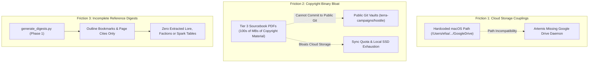
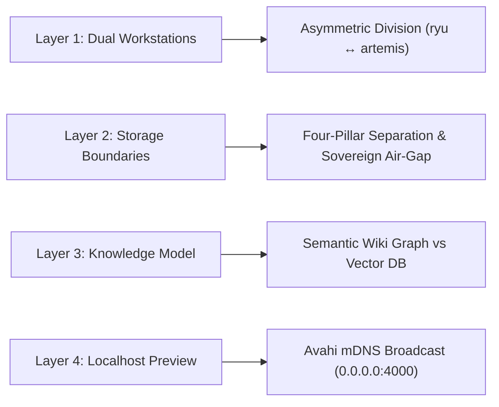
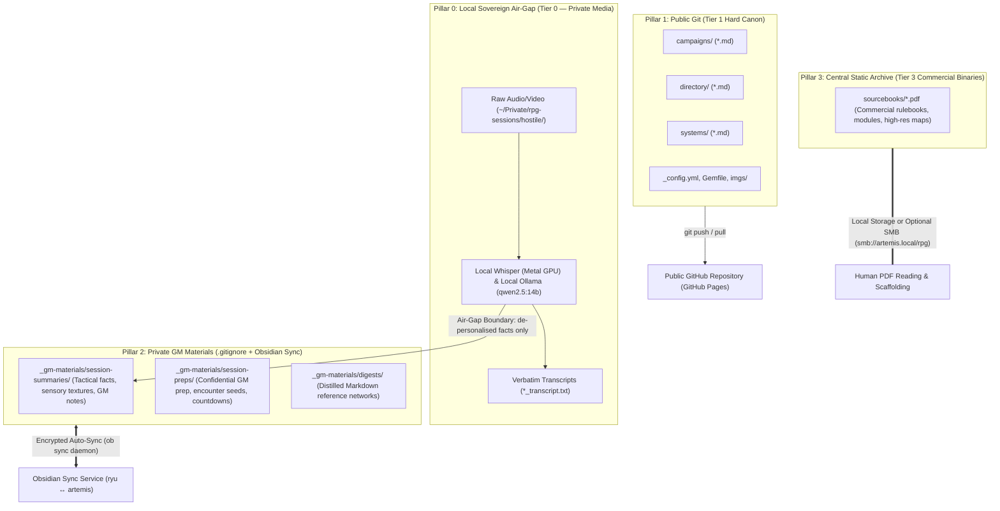
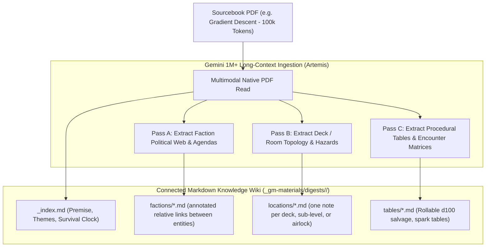

# ADR 003: Dual-Workstation Topology, Four-Pillar Storage, and Semantic Wiki Ingestion

- **Status:** Proposed
- **Date:** 2026-11-10
- **Author:** Antigravity (Pair Programming with Estevão Alvarenga)
- **Component:** `scripts/generate_digests.py`, `scripts/transcribe_session.py`, `skills/lookup-context/`, `templates/`, `docs/`, `src/oude_mechanismen/cli.py`
- **Origin:** Operational evaluation of `terra-campaigns/hostile` across MacBook Air (`ryu`) and Debian Linux (`artemis`)

---

## 1. Context & Problem Statement

In [ADR 001](001_dynamic_engine_vs_sync_distribution.md) and [ADR 002](002_python_cli_distribution_uv.md), `oude-mechanismen` successfully decoupled its static site generation into a dynamic RubyGem and centralised its Python tooling into a zero-clone CLI distribution (`oude`). Downstream campaign vaults (`hostile`, `charged`) now maintain clean repositories focused strictly on narrative canon and campaign configuration.

However, operational deployment across the author's real-world hardware topology—a portable MacBook Air (`ryu`) used at the tabletop and an always-on Debian Linux workstation (`artemis`) serving as a central development and agentic hub—exposed three fundamental friction points:



### Observed Operational Friction

1. **Cloud Sync Lock-In & Cross-OS Path Divergence:**
   `oude-mechanismen` historically parameterised its external session and digest directory via `drive_dir` in `.agents/context/tier1_sources.yml`. On macOS (`ryu`), this pointed to a machine-specific Google Drive path (`/Users/efsa/Library/CloudStorage/GoogleDrive-...`). On Debian Linux (`artemis`), Google Drive lacks a native first-party client. Running third-party sync daemons (like `rclone mount`) on Artemis adds unnecessary background services and authentication overhead.

2. **Copyright Binary Exposure vs Storage Bloat:**
   Tier 3 campaign lore comprises commercial RPG rulebooks, scenario modules, and gazetteer PDFs. Because downstream campaign repositories (`terra-campaigns/hostile`, `terra-campaigns/charged`) are **public** open-source sites, copyrighted PDFs cannot be committed to Git. Simultaneously, duplicating hundreds of megabytes of heavy static PDFs onto portable laptop SSDs wastes limited storage.

3. **The Incomplete Digest Defect:**
   The current digest generator (`scripts/generate_digests.py`) is merely a **structural table-of-contents scraper**. It uses `pypdf` to extract PDF bookmarks and page ranges (e.g. `pp. 14–28`), generating placeholder Markdown files in `_gm-materials/digests/`. The actual operational lore—room descriptions, hazard tables, faction politics, NPC stat blocks, and equipment rules—remains trapped inside the binary PDF, inaccessible to the AI agent during session prep and chapter drafting.

---

## 2. Multi-Layer Feasibility & Options Analysis

To establish a resilient, sovereign, and low-token workflow across machines, we evaluated the hardware capabilities, storage boundaries, and knowledge representation models:



---

### Layer 1: Asymmetric Dual-Workstation Division of Labour

Rather than attempting to make both machines functionally identical, the architecture embraces their asymmetric hardware strengths:

| Capability / Attribute | `ryu` (MacBook Air / macOS) | `artemis` (Debian 13 Linux Workstation) |
| :--- | :--- | :--- |
| **Physical Context** | Portable, battery-powered, tabletop companion | Fixed, always-on, high-bandwidth wired workstation |
| **Storage Capacity** | Constrained internal SSD | 420+ GB available local NVMe/SSD storage |
| **Hardware Strengths** | Apple Silicon Metal GPU (silent, high-efficiency Whisper) | Persistent CPU/RAM, background daemon runner, headless host |
| **Primary Responsibility** | **Tabletop Enclave & Tier 0 Ingest**: Audio recording, Whisper transcription, local air-gap | **Production Hub & Host**: Agentic synthesis, chapter drafting, art curation, 3-gate audits, Jekyll server |

---

### Layer 2: The Four-Pillar Storage Model & Sovereign Air-Gap

> **Clarification — Storage Pillars vs Canon Tiers:** The **Storage Pillars (0–3)** describe *physical storage locations, sync mechanisms, and privacy boundaries* (where bytes live and how they move). The **Canon Tiers (1–3)** describe the *narrative authority hierarchy* consulted during agent retrieval (which source outranks which). The two axes are orthogonal: a file's pillar determines its sync and privacy treatment, while its tier determines its evidentiary weight.

To completely remove Google Drive from Artemis, protect player privacy, and prevent copyright infringement on public Git repositories, we decouple campaign data into four strict operational pillars:



#### Pillar 0: Local Sovereign Air-Gap (Tier 0 — Private Media & Local Ingest)

- **Location**: `~/Private/rpg-sessions/<campaign>/` on local disk (`ryu`).
- **Contents**: Raw session audio and video recordings (`.mkv`, `.mp4`, `.wav`), unredacted verbatim speech-to-text transcripts (`<slug>_transcript.txt`), and acoustic calibration cache.
- **Execution & Models**: Strictly executed by **local, on-device sovereign models** (Apple Silicon Metal GPU Whisper via `whisper-cli`; local Ollama `qwen2.5:14b` for Pass 2A/2B de-personalisation).
- **Privacy Boundary**: **100% Air-Gapped**. Excluded from Git, Google Drive, Obsidian Sync, and all network shares. Never uploaded to cloud chat or hosted frontier APIs.
- **Air-Gap Clearance**: Only de-personalised, non-verbatim tactical facts (`<slug>_tactical_facts.md`) and sensory textures (`<slug>_sensory_textures.md`) ever cross the air-gap boundary into Pillar 2 (`_gm-materials/session-summaries/`).

#### Pillar 1: Public Git (Tier 1 — Canonical Published Lore & Static Site)

- **Location**: `campaigns/`, `directory/`, `systems/`, `imgs/`, `_config.yml`, `Gemfile`.
- **Contents**: Published session chronicles, player dossiers, setting gazetteers, and curated illustrations.
- **Boundary**: Public GitHub repository deployed via GitHub Actions to GitHub Pages. Zero player table chatter, zero real names, zero GM secrets.

#### Pillar 2: Private GM Materials & Digests (Tier 2 & Structured Tier 3 — Git-Ignored + Obsidian Sync)

- **Location**: The single unified root folder `_gm-materials/` directly inside the campaign workspace, containing `session-summaries/`, `session-preps/`, and `digests/`.
- **Contents**: De-personalised tactical facts, sensory textures, synthesised 8-section archival GM notes (`_gm-materials/session-summaries/`), confidential GM prep agendas, encounter seeds (`_gm-materials/session-preps/`), and distilled Markdown reference networks (`_gm-materials/digests/`).
- **Boundary**: Excluded from version control via `.gitignore`, and synchronised peer-to-peer / encrypted across `ryu` and `artemis` via the background **Obsidian Sync daemon** (`obsidian-sync.service`).
- **Jekyll Exclusion Invariant**: Although `_gm-materials/` starts with an underscore (`_`) so Jekyll skips rendering it as pages, defence-in-depth exclusion must still be enforced across **all four layers**: (1) `.gitignore` via `DEFAULT_GITIGNORE` in `src/oude_mechanismen/cli.py` (verified by `oude doctor`); (2) `_config.yml` `exclude:` (`"_gm-materials"` in `templates/jekyll/_config.yml.template`, verified by `oude doctor`); (3) `jekyll/_plugins/data_extractor.rb` (`f.start_with?("_gm-materials/")` so `catalog.json` / `all-content.md` never ingest private GM materials); (4) script/skill path updates in `scripts/transcribe_session.py`, `scripts/scribe_session.py`, `scripts/generate_digests.py`, `skills/lookup-context/`, `skills/prep-session/`, and `skills/scribe-session/`.
- **Operational Dependency Note**: Obsidian Sync (`obsidian-sync.service`) is an operational, host-level contract. The `oude` CLI and `oude doctor` cannot programmatically verify or enforce its presence or health; operators must confirm the daemon is running on both workstations out of band.
- **Path Portability**: Normalises `drive_dir` to `.` (the repository root). The same configuration works out of the box on macOS and Linux with zero environment variable juggling.

#### Pillar 3: Central Static Archive (Tier 3 — Commercial Copyright PDFs)

- **Location**: Local OneDrive on `ryu` or permanent local archive on `artemis` (optionally accessible via SMB at `smb://artemis.local/rpg`).
- **Contents**: Commercial rulebook PDFs, campaign scenario modules, and high-resolution map assets.
- **Boundary**: Completely decoupled from active session workflows. Never synced through Obsidian Sync and never committed to Git.

---

### Layer 3: Knowledge Representation — Flat Vector DB (RAG) vs Semantic Wiki Distillation

We critically evaluated how to transform raw Tier 3 sourcebook PDFs into rich, accessible context for the agent:

| Evaluation Criterion | Option A: Flat Vector Database (RAG / Embeddings) | Option B: Semantic Wiki Knowledge Graph (Obsidian-Native) |
| :--- | :--- | :--- |
| **Table & Statblock Integrity** | **Fails**: Standard chunking slices d100 encounter tables and NPC statblocks into incoherent fragments. | **Preserved**: Tables, mechanics, and stats are distilled into native Markdown tables. |
| **Relational Reasoning** | **Poor**: Vector similarity retrieves words, failing multi-hop queries (*"Which faction supplies weapons to Outpost 4?"*). | **Native**: Entities are connected via annotated relative Markdown links (`[Faction](../factions/faction.md)` $\rightarrow$ `[Location](../locations/location.md)`). |
| **Human Ergonomics** | **Opaque**: Binary vector stores cannot be browsed, audited, or edited in an Obsidian vault. | **Transparent**: Browsable in Obsidian Graph View and readable in any Markdown editor. |
| **Token Economy** | **Variable**: Retrieves multiple 500-token chunks with surrounding noise. | **Surgical**: Agent opens only the targeted note (`deck_01.md`), spending ~300 tokens. |



#### Decision: Adopt Option B (Semantic Wiki Knowledge Graph)

Leveraging modern multimodal LLMs with 1M+ token context windows (Gemini Pro/Flash), sourcebooks are ingested in a single comprehensive pass and compiled into a structured, hyperlinked Markdown knowledge wiki within `_gm-materials/digests/<source>/` (see Section 3.5 for the target format).

---

### Layer 4: Multi-Device Localhosting & LAN Broadcast

To test newly authored chapters across devices (MacBook Air, iPad, smartphone) before committing:

1. **mDNS Resolution**: `artemis` runs `avahi-daemon.service`, broadcasting `artemis.local` across the local Wi-Fi subnet (`192.168.2.0/24`). Zero manual IP configuration is required on Apple or Linux client devices.
2. **Server Binding**: Jekyll serves on all interfaces:
   ```bash
   bundle exec jekyll serve --host 0.0.0.0 --port 4000 --livereload --config _config.yml,_config_dev.yml
   ```
3. **URL Decoupling**: A lightweight development overlay (`_config_dev.yml`) overrides production GitHub Pages URLs (`url: ""`, `baseurl: ""`), ensuring relative links and stylesheet assets resolve properly on local network browsers.

---

## 3. Detailed Technical Specification

Throughout this section, `compile_references()` in `scripts/generate_digests.py` must index digests recursively and portably:
- Replace the non-recursive `digests_dir.glob("*.md")` with `digests_dir.rglob("*.md")` so that nested `_gm-materials/digests/<source>/**/*.md` semantic wiki notes are compiled into `.agents/context/references.json`.
- Derive `"slug"` from the path relative to `digests_dir` (e.g. `md_file.relative_to(digests_dir).with_suffix("").as_posix()`, yielding `"<source>/_index"`) rather than bare `md_file.stem`, preventing collisions between identically named files across different sourcebooks.
- Store `"digest_path"` relative to `drive_dir` (using POSIX separators) rather than as a machine-specific absolute path (`str(md_file)`), keeping `references.json` portable across `ryu` and `artemis`.

### 3.1 Normalised Campaign Configuration (`tier1_sources.yml.template`)

Update starter and active `tier1_sources.yml` files to treat the local vault as the root for private session and digest records. The `drive_dir` key is retained as a **backwards-compatible configuration alias** for the campaign working directory; setting `drive_dir: .` anchors Tier 2 sessions and Tier 3 digests to the repository root:

```yaml
# .agents/context/tier1_sources.yml
# drive_dir is retained as a backwards-compatible alias for the campaign working
# directory. When set to '.' or a relative path, Tier 2 session records and Tier 3
# digests reside directly within the vault in the .git-ignored unified root folder
# _gm-materials/ (session-summaries/, session-preps/, digests/).
drive_dir: .

include_paths:
  - campaigns
  - directory
  - systems

exclude_paths:
  - _inklings.md
  - _TODO.md
  - _notions.md
```

### 3.2 Standardised `.gitignore` via the `oude` CLI

On `main` (`v0.5.0+`), `templates/jekyll/.gitignore.template` no longer exists; `.gitignore` is managed programmatically via the `DEFAULT_GITIGNORE` constant and the `_ensure_gitignore()` function in `src/oude_mechanismen/cli.py`. Enshrine the Four-Pillar privacy boundary by adding the unified `_gm-materials/` root to `DEFAULT_GITIGNORE`, preserving all existing entries:

```gitignore
# Private GM materials: session summaries, session preps, and reference digests (backed up via Obsidian Sync)
_gm-materials/

# Local Jekyll build artefacts and engine state
_site/
.jekyll-cache/
.sass-cache/
.DS_Store
.agents/venv/
__pycache__/
*.pyc
.env
.bundle/
vendor/
*_studio.html
*_preview_*.png
*_raw.*
```

Additionally, extend `oude doctor` with remediation checks that verify existing campaign vaults carry these entries in their `.gitignore` and report (or repair) any missing pillar exclusions.

Although `_gm-materials/` starts with an underscore so Jekyll skips rendering it as pages, defence-in-depth exclusion must still be enforced across **all four layers**:

1. **`.gitignore`**: `_gm-materials/` in `DEFAULT_GITIGNORE` in `src/oude_mechanismen/cli.py`, verified by `oude doctor`.
2. **`_config.yml` `exclude:`**: `"_gm-materials"` in `templates/jekyll/_config.yml.template`, verified by `oude doctor`.
3. **`jekyll/_plugins/data_extractor.rb`**: reject `f.start_with?("_gm-materials/")` alongside the existing `_site/`, `vendor/`, `.git/`, `_plugins/`, and `.agents/` rejections, so `catalog.json` / `all-content.md` never ingest private GM materials.
4. **Script/skill path updates**: `scripts/transcribe_session.py`, `scripts/scribe_session.py`, `scripts/generate_digests.py`, `skills/lookup-context/`, `skills/prep-session/`, and `skills/scribe-session/` must resolve session summaries, session preps, and digests under `_gm-materials/`.

### 3.3 Dynamic Script Path Resolution

Update `find_drive_dir` in `scripts/transcribe_session.py` and `scripts/generate_digests.py` (harmonising the signature `explicit_drive_dir: Optional[str] = None` across both) to resolve relative `drive_dir` values directly against `repo_root` while preserving strict fail-loud validation:

```python
def find_drive_dir(repo_root: Path, explicit_drive_dir: Optional[str] = None) -> Path:
    """Resolve campaign working directory from tier1_sources.yml, relative to repo root."""
    if explicit_drive_dir:
        p = Path(explicit_drive_dir).expanduser()
        target = (repo_root / p).resolve() if not p.is_absolute() else p.resolve()
        if target.is_dir():
            return target
        raise FileNotFoundError(
            f"Explicit drive_dir '{explicit_drive_dir}' does not exist or is not a directory."
        )

    config_file = repo_root / ".agents" / "context" / "tier1_sources.yml"
    if config_file.exists():
        try:
            cfg = yaml.safe_load(config_file.read_text(encoding="utf-8")) or {}
        except Exception as e:
            print(f"[WARN] Failed to read drive_dir from {config_file}: {e}", file=sys.stderr)
            raise
        raw = cfg.get("drive_dir")
        if raw:
            p = Path(raw).expanduser()
            target = (repo_root / p).resolve() if not p.is_absolute() else p.resolve()
            if target.is_dir():
                return target
            raise FileNotFoundError(
                f"Configured drive_dir '{raw}' does not exist or is not a directory."
            )
    # Fall back to the repository root only when drive_dir is omitted or unset.
    return repo_root
```

### 3.4 Multi-Device Localhost Preview Overlay (`_config_dev.yml`)

Provide a standard development configuration template in `templates/jekyll/_config_dev.yml.template`:

```yaml
# Development overlay for multi-device LAN testing (0.0.0.0 / artemis.local)
url: ""
baseurl: ""
```

### 3.5 Target Digest Wiki Format (`_gm-materials/digests/<source_name>/`)

`oude digest-deep` (delivered in Phase 3) transforms a Tier 3 sourcebook PDF into a navigable knowledge wiki under `_gm-materials/digests/<source_name>/`. The format below is the target design: multi-file entity granularity, standard relative Markdown links, a canonical note schema, and a lean recursive index.

#### 3.5.1 Multi-File Entity Granularity (No Monolithic Files)

Each sourcebook produces multiple files — normally one per entity or cohesive mechanical subsystem — never a single massive file. The goal is to let agents navigate through related files instead of loading one monolithic document:

```text
_gm-materials/digests/<source_name>/
├── _index.md                  # Entry-point hub
├── factions/                  # One note per faction or organisation
├── locations/                 # One note per deck, sub-level, room, or station
├── entities/                  # One note per NPC, creature, or notable item
├── mechanics/                 # One note per cohesive rules subsystem
└── tables/                    # One note per rollable table or generator
```

- `_index.md` is the entry-point hub: book premise, themes, survival/campaign clocks, a chapter/page map, and annotated links to the entity folders and top-level entities.
- The categorised subdirectories (`factions/`, `locations/`, `entities/`, `mechanics/`, `tables/`) are adaptable to both module/dungeon books (*Gradient Descent*) and core rulebooks/gazetteers (*Hostile*); a sourcebook may omit categories it does not need.
- **Target sizing rule**: each note should be roughly 30–120 lines (~300–1,200 tokens), so one targeted `read_file` yields full operational detail on the entity without pulling in unrelated chapters.

#### 3.5.2 Hyperlink Strategy: Relative Markdown Links vs Wikilinks

| Criterion | `[[wikilinks]]` | Standard relative Markdown links |
| :--- | :--- | :--- |
| **Obsidian rendering** | Native graph view and link resolution. | Rendered and graphed natively by Obsidian as standard Markdown links. |
| **Agent navigation cost** | Requires a filename search hop to resolve `[[Name]]` to a file. | `read_file` / `view_file` / `lookup-context` get the exact filesystem path in zero extra search hops. |
| **Collision safety** | Ambiguous when two `<source_name>` folders contain an entity with the same name. | Zero filename collision across different `<source_name>` folders, because every link carries its full relative path. |
| **Portability** | Vault-relative resolution depends on Obsidian settings. | Plain relative paths work in any Markdown renderer and in Git. |

**Decision**: use **standard relative Markdown links** (`[Label](../category/entity.md)`), because (1) Obsidian renders and graphs them natively, and (2) AI agents obtain the exact filesystem path in zero extra search hops with zero filename collision across different `<source_name>` folders.

**Annotated links are mandatory**: every link must carry a short annotation so an agent knows *why* to follow it before spending tokens opening the file:

```markdown
- [Troubleshooters](../factions/troubleshooters.md) — patrol this deck and demand salvage tax.
```

#### 3.5.3 Canonical Note Schema (YAML Frontmatter + Body Structure)

Every entity note follows one canonical schema. YAML frontmatter:

```yaml
---
source: gradient_descent
source_pdf: modules/gradient_descent.pdf
pages: "14-18"
tier: 3
entity_type: faction
title: Troubleshooters
tags: [salvage, deck-patrol, antagonist]
related: ["../locations/sub_level_01.md", "../tables/salvage_d100.md"]
---
```

Markdown body template:

```markdown
# <Title>

<1–2 sentence executive summary — fast orientation in lines 1–25.>

## Overview

<Context, goals, and current state, with inline page citations like [p. 14] or [pp. 14–18].>

## Key Details / Rules / Hazards

<Native Markdown tables for statblocks and rollable tables; operational mechanics.>

## Connections / See Also

- [Related entity](../category/entity.md) — one-line reason to follow the link.
```

Invariants: a blank line follows every heading (`#`–`####`); page citations use `[p. 14]` / `[pp. 14–18]`; statblocks and rollable tables are native Markdown tables.

#### 3.5.4 Index & Retrieval Performance (`.agents/context/references.json` & `lookup-context`)

`compile_references()` in `scripts/generate_digests.py` recursively indexes `_gm-materials/digests/<source_name>/**/*.md` into `.agents/context/references.json` without bloating the index. Each entry carries:

- `slug`: collision-free relative identifier `<source_name>/<rel_path_without_ext>` (e.g. `gradient_descent/factions/troubleshooters`).
- `digest_path`: portable POSIX path relative to `_gm-materials/digests/` (or `drive_dir`), never a machine-specific absolute path.
- `source`, `entity_type`, `pages`, `title`, and `sections` (headings plus line numbers).
- Optional lightweight `summary` / `tags` — never duplicating full note bodies into `references.json`.

**Progressive 3-hop agent retrieval workflow**:

1. Consult `.agents/context/references.json` to locate the `<source_name>/<rel_path>` slug and its sections.
2. Open `_index.md` or the targeted entity file via its relative `digest_path`.
3. Follow annotated relative links to connected entity notes only when the annotation justifies the hop.

#### 3.5.5 Empirical Validation Plan

`oude digest-deep` is scoped for Phase 3 implementation. Before finalising the extraction prompts and tooling, empirical format and navigation experiments will be run against **Gradient Descent** (scenario module) and **Hostile** (core/setting sourcebook), measuring note sizing adherence, link-graph navigability, and `references.json` index leanness.

---

## 4. Consequences & Benefits

### Positive Consequences

1. **Zero Cloud Account Sync on Linux**: Artemis does not need Google Drive authentication, OAuth refresh tokens, or FUSE mounts.
2. **Deterministic Privacy Air-Gap**: Table secrets, unredacted session prep, and candidate rulings are physically barred from entering public Git history via `.gitignore`.
3. **Automated Multi-Device Continuity**: Obsidian Sync handles background synchronisation of Markdown notes seamlessly across `ryu`, `artemis`, and mobile devices.
4. **Rich Knowledge Representation**: Transitioning from bare TOC digests to a connected Markdown wiki unleashes deep contextual grounding for Antigravity with zero token waste during routine queries.
5. **Instant Local Network Validation**: Any device on the home network can preview live formatting, image galleries, and cross-references at `http://artemis.local:4000`.

### Negative Consequences & Mitigations

1. **Manual Ingestion Effort for Large Books**: Deep knowledge graph extraction from PDFs requires dedicated prompt execution.
   - *Mitigation*: Automated via the forthcoming `oude digest-deep` CLI command / Antigravity skill (Phase 3) using Gemini long-context ingestion, following the Section 3.5 target format.
2. **Obsidian Sync File Count**: Creating dozens of sub-notes for a single sourcebook increases vault note count.
   - *Mitigation*: Keep digests scoped within modular sub-folders (`_gm-materials/digests/<source>/`) with the Section 3.5 sizing rule (~30–120 lines per note), avoiding monolithic single-file dense matrices.

---

## 5. Implementation Roadmap

- [x] **ADR 003 Formulation**: Codify dual-workstation topology, four-pillar storage, and semantic wiki digestion.
- [ ] **Phase 1: Path & Gitignore Normalisation**: Update `scripts/generate_digests.py`, `scripts/transcribe_session.py`, `src/oude_mechanismen/cli.py` (`DEFAULT_GITIGNORE`, `_ensure_gitignore()`, `oude doctor` checks), and templates to support relative `drive_dir: .`. Also update `AGENTS.md` (§1 & §4) to replace references to Google Drive `_sessions/` with the Four-Pillar `.gitignore` + Obsidian Sync boundary anchored at `_gm-materials/`, and update `compile_references()` in `scripts/generate_digests.py` to recursive `rglob("*.md")` indexing with relative `slug` and `digest_path` values.
  - *Acceptance criteria*: Unit tests covering relative `drive_dir: .` resolution against `repo_root` and `FileNotFoundError` raised on missing explicit or configured paths; `DEFAULT_GITIGNORE` test assertions in `tests/test_cli.py` verifying `_gm-materials/` and all preserved entries; `oude doctor` checks verifying `"_gm-materials"` in `_config.yml` `exclude:` and the `f.start_with?("_gm-materials/")` rejection in `jekyll/_plugins/data_extractor.rb`; recursive `_gm-materials/digests/**/*.md` indexing tests confirming nested semantic wiki notes appear in `.agents/context/references.json` with collision-free relative `slug`s and portable relative `digest_path`s.
- [ ] **Phase 2: Localhost Development Tooling**: Add `_config_dev.yml.template` and an `oude serve` subcommand in `src/oude_mechanismen/cli.py` wrapping `bundle exec jekyll serve --host 0.0.0.0 --port 4000 --livereload --config _config.yml,_config_dev.yml` with LAN binding (`0.0.0.0:4000`).
  - *Acceptance criteria*: `oude serve` launches Jekyll bound to `0.0.0.0:4000` with livereload and the dev overlay config; the site is reachable at `http://artemis.local:4000` from another LAN device via Avahi mDNS.
- [ ] **Phase 3: Book-to-Wiki Knowledge Synthesiser (`oude digest-deep`)**: Develop the `oude digest-deep` CLI command, prompt templates, and procedural skill (`skills/digest-book/`) to extract rich relational knowledge wikis from sourcebook PDFs into nested `_gm-materials/digests/<source>/**/*.md` following the Section 3.5 target format (multi-file entity granularity, annotated relative Markdown links, canonical note schema), indexed recursively into `references.json` via the `rglob("*.md")` change from Phase 1.
  - *Acceptance criteria*: Empirical format and navigation experiments run against *Gradient Descent* (scenario module) and *Hostile* (core/setting sourcebook); a sample sourcebook produces a hyperlinked multi-file Markdown knowledge wiki under `_gm-materials/digests/<source>/` with an `_index.md` hub and ~30–120-line entity notes; `compile_references()` with `rglob("*.md")` indexes every nested note into `.agents/context/references.json` with collision-free relative `slug`s; `lookup-context` retrieves entities from the nested notes via the 3-hop workflow.
