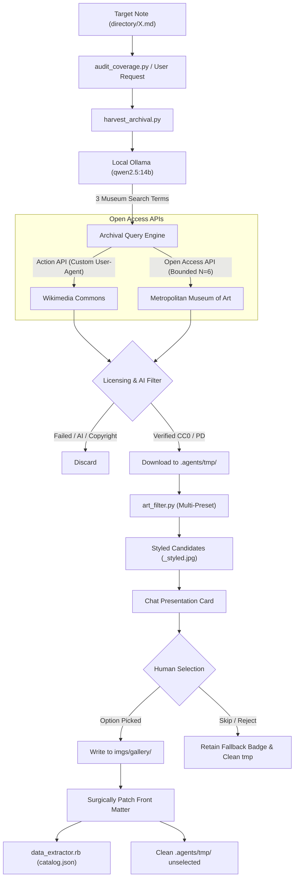

# Design Specification: The Archival Scriptorium (Non-AI Asset Harvester)

**Document ID:** `docs/designs/001_archival_scriptorium.md`  
**Status:** Approved  
**Author:** Elephant Agent & Developer  
**Target Milestone:** `v0.4.0`  

---

## 1. Overview & Objectives

The **Archival Scriptorium** is an autonomous, non-AI cultural heritage excavator and graphic-novel asset pipeline for tabletop RPG campaign vaults. It provides the procedural engine and agent tooling to discover, retrieve, style, and integrate genuine historical artworks, engravings, schematics, and museum artefacts into campaign wiki notes without burning cloud frontier model quota or violating aesthetic and privacy air-gaps.

### Goals

* **Deterministic Archival Discovery:** Query public domain cultural institutions using open, keyless APIs (Wikimedia Commons Action API and The Metropolitan Museum of Art Open Access API).
* **Strict Anti-AI & Licensing Verification:** Programmatically verify machine-readable Public Domain / CC0 / CC-BY licensing metadata, rejecting copyrighted or AI-generated media.
* **Zero Cloud Quota Burn:** Offload entity-to-archive query expansion entirely to local Ollama (`qwen2.5:14b`), executing searches and graphic-novel styling 100% on-device.
* **Headless Aesthetic Transformation:** Integrate directly with `art_filter.py`, transforming harvested raw historical assets into high-resolution graphic-novel illustrations using vault-specific palette stops (`aesthetics.yml`), generating multi-preset styled variants.
* **Chat-Native Pair-Programming Ergonomics:** Present 2–3 styled candidates with full provenance directly in the conversational turn for rapid human curation, eliminating detached external web interfaces under Occam's razor.
* **Atomic Vault Integration:** Autonomously write approved assets to `imgs/gallery/`, update note front matter using strict note-relative paths (`images:` array and HTML `footer_content:` hyperlink attribution), and refresh `.agents/context/catalog.json`.
* **Universal Downstream Distribution:** Package the harvester for downstream campaign vaults (`charged`, `hostile`) via `templates/runners/` and `sync.sh` synchronisation.

### Non-Goals

* **Generative AI Art Generation:** The engine will never interface with Midjourney, DALL-E, Stable Diffusion, or local diffusion checkpoints. All visuals must be authentic historical artefacts.
* **Mandatory API Keys:** Developer keys for private or commercial services (e.g. Rijksstudio, Europeana) are explicitly excluded from the Phase 1 core and deferred to optional progressive enhancement.
* **Unsupervised Front-Matter Mutation:** The engine will never silently modify wiki notes or assign illustrations without explicit human selection.
* **Replacing Fallback Geometric Badges:** Unillustrated entries displaying canonical fallback badges (`imgs/badges/`) remain completely valid; missing custom illustrations will never trigger lint or build errors.

---

## 2. Domain Framing & User/System Experience

The Archival Scriptorium operates in two distinct modes across campaign vaults:

### Mode 1: Surgical Single-Entry Illustration (`illustrate-entry`)

When the user or GM asks to illustrate a specific note (e.g. `"Illustrate directory/Atles/IronPot.md"`):

1. The agent executes `python3 scripts/harvest_archival.py --entity <path_to_note>`.
2. The script extracts note metadata, prompts local Ollama (`qwen2.5:14b`) for 3 pre-20th-century historical search terms, and queries open museum collections.
3. The top 2–3 verified public domain images are downloaded into `.agents/tmp/` and styled via `art_filter.py` across active presets.
4. The agent showcases the candidates in chat with image links, museum accession details, and licences.
5. The human picks an option (or chooses to retain the fallback badge).
6. The approved asset is copied to `imgs/gallery/<slug>.jpg`, front matter is updated with relative paths, unselected temp files are cleaned, and `catalog.json` is regenerated.

### Mode 2: Vault Gap Audit & Batch Discovery (`audit_coverage.py --unillustrated`)

When auditing campaign readiness:

1. The GM runs `python3 scripts/audit_coverage.py --unillustrated`.
2. The script scans all markdown files across `directory/`, `campaigns/`, and `systems/`, identifying entries lacking an `images:` array or pointing to `/imgs/badges/`.
3. The GM can select entries from the generated list to feed directly into the surgical harvest pipeline.

---

## 3. State Schema & Data Models

### 3.1 Harvested Candidate Schema (`ArchivalCandidate`)

```python
from dataclasses import dataclass, field
from pathlib import Path
from typing import Dict, Optional

@dataclass
class ArchivalCandidate:
    candidate_id: str                      # Deterministic hash of source URL
    title: str                             # Original title of the artwork / artefact
    creator: str                           # Artist, engraver, or "Unknown"
    date_created: str                      # e.g. "ca. 1780", "16th century", "Edo period"
    institution: str                       # e.g. "The Metropolitan Museum of Art", "Wikimedia Commons"
    source_page_url: str                   # Canonical permalink to object page
    raw_image_url: str                     # Direct URL to high-resolution asset
    licence: str                           # e.g. "Public Domain", "CC0", "CC BY 4.0"
    is_public_domain: bool                 # Programmatically verified flag
    raw_file_path: Optional[Path] = None   # Local path in .agents/tmp/
    styled_variants: Dict[str, Path] = field(default_factory=dict) # Preset -> styled asset path
    matched_query: str = ""                # The search query that yielded this object
```

### 3.2 Target Note Front-Matter Contract & Path Resolution

To ensure compatibility with Jekyll's `_plugins/data_extractor.rb` and the theme's `_includes/footer_custom.html`, front-matter mutation must adhere strictly to two invariants:

1. **Directory-Depth Relative Pathing:** Image paths must be calculated relative to the directory of the target note, never as absolute repository paths:
   - Note at `directory/Atles/IronPot.md` $\rightarrow$ `- ../../imgs/gallery/iron-pot.jpg`
   - Note at `campaigns/gradient-descent/001.md` $\rightarrow$ `- ../../imgs/gallery/station_airlock.jpg`
   - Note at repository root (`index.md`) $\rightarrow$ `- imgs/gallery/cover.jpg`
2. **HTML Hyperlink in `footer_content:`:** The theme renders `{{ page.footer_content }}` without markdown parsing. Attribution must be formatted as raw, clean HTML with `target="_blank"` and `rel="noopener noreferrer"`:

```yaml
---
layout: default
title: "Iron Pot"
parent: "Atles"
images:
  - ../../imgs/gallery/iron-pot.jpg
footer_content: 'Image adapted from <a href="https://commons.wikimedia.org/wiki/File:..." target="_blank" rel="noopener noreferrer">Cast-iron Tetsubin kettle</a> (Edo period), Rijksmuseum collection via Wikimedia Commons. CC0.'
---
```

---

## 4. Invariants & Rules

* **Invariant 1 (Strict Non-AI Provenance):** No image may be downloaded or presented if metadata, category names, or descriptions contain case-insensitive generative AI markers (`ai-generated`, `midjourney`, `stable diffusion`, `dall-e`, `generative ai`).
* **Invariant 2 (Machine-Readable Rights Verification):** Every candidate must possess an explicit machine-readable rights statement. Values from Wikimedia (`extmetadata.LicenseShortName.value`) and The Met (`isPublicDomain: true`) must match normalised regex patterns (`CC0`, `CC BY`, `CC-BY`, `PD-`, `Public Domain`). Unclear or copyrighted assets must be discarded immediately.
* **Invariant 3 (Canonical Badge Fallback):** Vault entries without an illustration are first-class citizens using fallback geometric badges (`/imgs/badges/`). Scriptorium failures or human rejection must never break builds or generate lint warnings.
* **Invariant 4 (Zero Cloud Token Burn):** All query formulation, semantic expansion, and image processing must run locally on-device. No cloud LLM APIs may be called during harvest operations.
* **Invariant 5 (Atomic Human Approval Gate):** Front-matter mutation and asset persistence to `imgs/gallery/` require explicit human confirmation (`[SEMI]` execution mode).
* **Invariant 6 (Relative Path Integrity):** All image references written to front matter must be resolved relative to the target note's directory depth to ensure 100% backlink indexing by `_plugins/data_extractor.rb`.
* **Invariant 7 (Workspace Disk Hygiene):** Temporary candidate downloads in `.agents/tmp/` must be ignored by Git via `.gitignore`, and discarded candidate assets must be cleaned up automatically upon selection or termination.

---

## 5. Execution & State Mutation Logic



### 5.1 Step-by-Step Processing

1. **Query Generation:** `harvest_archival.py` inspects the target note's `title`, `parent`, and first 300 words. It dispatches a local prompt to `qwen2.5:14b` over `localhost:11434` enforcing British English:  
   *"Given this fantasy/sci-fi RPG entity, provide exactly three pre-20th-century historical museum search queries (e.g. architectural ruin, botanical engraving, antique automaton). Return JSON array of strings."*  
   *Fallback:* If Ollama is offline or times out (5s), fall back deterministically to `[title, f"{title} engraving", f"{parent} artefact"]`.
2. **Archival API Dispatch:**
   - **The Met Museum:** Queries `https://collectionapi.metmuseum.org/public/collection/v1/search?hasImages=true&isPublicDomain=true&q={query}`. Constrains inspection to a maximum of 6 object IDs per search query. Iterates through IDs fetching details, requiring non-empty `primaryImageSmall` (or `primaryImage`), enforcing a 5.0s request timeout.
   - **Wikimedia Commons:** Queries `https://commons.wikimedia.org/w/api.php?action=query&generator=search&gsrnamespace=6&gsrsearch={query}+filetype:bitmap&prop=imageinfo&iiprop=url|extmetadata&format=json`. Mandates a compliant `User-Agent: OudeMechanismenHarvester/0.3.0 (https://github.com/terra-campaigns/oude-mechanismen; contact@terra-campaigns)`.
3. **Licence & Anti-AI Verification:**
   - Evaluates `LicenseShortName` against normalised regex `^(cc0|cc[ -]by|pd|public domain)`.
   - Inspects `Categories` and description text, rejecting any asset containing `ai-generated`, `midjourney`, `stable diffusion`, `dall-e`, or `generative ai`.
   - Requires image width $\ge 800\text{px}$ to ensure high-fidelity graphic-novel print quality.
4. **Download & Multi-Preset Styling:** Downloads top 1–2 candidates per collection to `.agents/tmp/`. Invokes `scripts/art_filter.py` with vault presets (`aesthetics.yml`), generating styled JPG variants (`styled_variants`) for each active preset.
5. **Human Selection & Note Patching:** Displays markdown preview card. Upon selection:
   - Moves selected variant to `imgs/gallery/<slug>.jpg`.
   - Surgically patches note front matter: calculates relative depth (e.g. `../../imgs/gallery/<slug>.jpg`), prepends to existing `images:` (or replaces placeholder badge), and writes raw HTML attribution into `footer_content:`.
   - Purges remaining unselected files from `.agents/tmp/`.
   - Re-indexes catalogue via `ruby --disable-gems _plugins/data_extractor.rb`.

### 5.2 Pure-Function Decomposition

To guarantee testability without brittle network mocking, `scripts/harvest_archival.py` decomposes into pure, deterministic functions:

```python
def parse_met_object_payload(data: dict) -> Optional[ArchivalCandidate]:
    """Extract candidate from Met Museum object JSON, enforcing isPublicDomain."""

def parse_wikimedia_imageinfo(data: dict) -> List[ArchivalCandidate]:
    """Parse Wikimedia query response into candidate list, handling dictionary metadata."""

def validate_licence_string(licence_str: str) -> bool:
    """Case-insensitive normalisation and regex validation for CC0/CC-BY/PD licences."""

def is_ai_provenance(categories: Union[List[str], str], description: str = "") -> bool:
    """Case-insensitive lexical scan for generative AI markers."""

def calculate_relative_image_path(note_path: Path, repo_root: Path, image_rel_path: str) -> str:
    """Calculate relative path from note directory to image asset (e.g. ../../imgs/gallery/x.jpg)."""

def format_footer_html(candidate: ArchivalCandidate) -> str:
    """Generate theme-compliant HTML attribution string."""

def generate_deterministic_fallback_queries(note_metadata: dict) -> List[str]:
    """Derive fallback queries when local Ollama is offline."""

def patch_note_frontmatter(content: str, rel_image_path: str, footer_html: str) -> str:
    """Surgically update front matter without disturbing existing comments or body text."""
```

---

### 5.3 Downstream Vault Distribution (`sync.sh`)

As an upstream engine tool, the harvester must be packaged for downstream campaign vaults:

1. **Runner Script Template:** Create `templates/runners/harvest_archival.py.template` which invokes the engine's core script with proper virtual environment discovery (`.agents/venv`).
2. **Sync Manifest Registration:** Add `.agents/scripts/harvest_archival.py` to `MANAGED_FILES` in `sync.sh`.
3. **Skill Workflow Update:** Update `skills/illustrate-entry/SKILL.md` to document the automated harvest command, chat carousel prompt, and human curation step.
4. **Git Hygiene:** Add `.agents/tmp/` to `.gitignore` across templates and upstream repository.

---

## 6. Edge Cases & Failure Modes

* **Network Outage / API Rate Limiting:** HTTP 429 or connection timeouts are caught defensively. The script logs a concise warning to stderr and exits with status 0, informing the agent that the archive was temporarily unreachable.
* **Zero Search Hits:** If esoteric terms produce no hits, the script attempts a fallback query using the raw note title and parent folder name. If still empty, it reports `"No public domain assets found"` and exits cleanly without error.
* **Corrupt Image Data:** If a downloaded file is not a valid JPEG/PNG, `PIL.Image.open()` catches `UnidentifiedImageError`, deletes the corrupt file, and proceeds to the next candidate.
* **Existing Gallery Arrays:** If a note already contains multiple images, the new asset is prepended to `images:` without clobbering existing items.
* **Ollama Offline / Unresponsive:** If `localhost:11434` is not running, the script falls back gracefully to deterministic keyword extraction from note front matter without failing.

---

## 7. Verification & Automated Test Strategy

### Unit Tests (`tests/test_harvest_archival.py`)

* **Licensing Validator Assertion:** Test that assets marked `CC0`, `Public domain`, `CC BY 4.0`, `PD-Art`, and `Public Domain Mark` pass validation, while assets marked `All Rights Reserved` or missing rights metadata are rejected.
* **AI Provenance Rejection Assertion:** Test that fixtures with `Category:AI-generated images`, `Category:Images generated with Midjourney`, or body text containing `DALL-E` are rejected immediately.
* **Met Museum Response Parser:** Test extraction of `primaryImageSmall`, artist, and accession number from sample Met API JSON payloads; test skipping when `primaryImage` is empty.
* **Wikimedia Commons Response Parser:** Test parsing of dictionary `extmetadata.LicenseShortName.value` and thumbnail resolution calculation.
* **Relative Path Calculation:** Test calculating relative paths across varied directory depths (`directory/Atles/IronPot.md` $\rightarrow$ `../../imgs/gallery/...`, root `index.md` $\rightarrow$ `imgs/gallery/...`).
* **HTML Footer Attribution:** Test that `format_footer_html` emits valid HTML `<a>` tags with `target="_blank"` and `rel="noopener noreferrer"`.
* **Surgical Front-Matter Patching:** Test that updating front matter preserves Dataview code blocks, comments, and existing YAML fields.

### Integration Tests

* Execute a dry-run harvest against a mock entity note using local test fixtures, verifying candidate downloading, multi-preset styling through `art_filter.py`, and relative markdown front-matter generation.

---

## 8. Goldfish Review Gates

- [x] Zero-context Goldfish review completed (Round 1: Revisions Required)
- [x] Logic contradictions, path resolution hazards, and edge-case holes addressed (PROBE-01 through PROBE-11 resolved)
- [x] Round 2 Goldfish verification sign-off
- [ ] Human developer approval signed off
