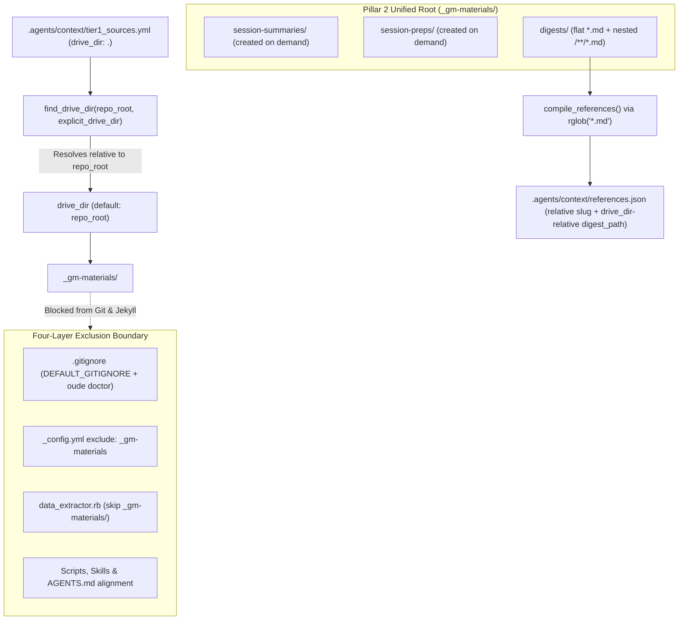

# Design 003: ADR 003 Phase 1 — Path & Gitignore Normalisation

*   **Author:** Estevão Alvarenga (`efsalvarenga`) / Antigravity
*   **Status:** Proposed
*   **Date:** 2026-11-13

--------------------------------------------------------------------------------

## Overview

Phase 1 of [ADR 003](../adr/003_dual_workstation_topology_and_semantic_wiki_ingestion.md) decouples `oude-mechanismen` from machine-specific Google Drive paths and anchors all private Game Master (GM) materials inside the campaign vault (the downstream Git and Obsidian repository for an individual tabletop RPG campaign) under a single git-ignored directory, `_gm-materials/`. It also updates the reference index compiler (`compile_references()`) to index nested Markdown directories recursively with collision-free relative slugs and portable paths, preparing the vault layout for Phase 2 (`oude serve`) and Phase 3 (`oude digest-deep`).

## The Problem

Deploying `oude-mechanismen` campaign vaults across both a macOS laptop (`ryu`) and a Debian Linux workstation (`artemis`) exposed four structural issues in the current path and indexing model:

1. **OS-Coupled `drive_dir` Paths:** `.agents/context/tier1_sources.yml` historically pointed `drive_dir` to a macOS Google Drive path (`/Users/efsa/...`). Debian Linux lacks an official Google Drive client, so scripts fail on `artemis` unless operators maintain external mount daemons or rewrite config files per machine.
2. **Broken Relative Path Resolution & Divergent Fallbacks:** `find_drive_dir()` in `scripts/generate_digests.py` (`explicit_drive_dir: str = None`, lacking `.resolve()`) and `scripts/transcribe_session.py` (`explicit_drive_dir: Optional[str] = None`, calling `.resolve()` against CWD) resolve relative paths against the caller's working directory rather than `repo_root`, check `.exists()` instead of `.is_dir()`, and raise `FileNotFoundError` when `drive_dir` is omitted. Meanwhile, `resolve_drive_dir()` in `scripts/audit_coverage.py` parses `tier1_sources.yml` via regex, falls back to a macOS-only `~/Library/CloudStorage/GoogleDrive-*` glob, and returns `None` instead of `repo_root`.
3. **Fragmented Private Folders Without Exclusion:** Session records (`_sessions/`), confidential prep (`_prep/`), and reference digests (`_digests/`) live at separate top-level locations outside the standard `.gitignore` template (`DEFAULT_GITIGNORE` in `src/oude_mechanismen/cli.py`), `_config.yml` `exclude:`, and `jekyll/_plugins/data_extractor.rb` exclusion list. Placing them inside the vault without four-layer exclusion risks leaking private table notes or copyrighted digest text into public Git history and Jekyll builds.
4. **Flat, Non-Portable Reference Indexing:** `compile_references()` in `scripts/generate_digests.py` uses non-recursive `glob("*.md")`, derives `"slug"` from bare `md_file.stem`, and writes absolute OS paths into `.agents/context/references.json`. Nested multi-file wikis are silently ignored, identically named entity files across sourcebooks would collide, and `references.json` cannot stay identical across `ryu` and `artemis`.

## Goals

*   Anchor Pillar 2 private GM materials (defined in [ADR 003 §2](../adr/003_dual_workstation_topology_and_semantic_wiki_ingestion.md) as git-ignored GM working files synced across workstations: `session-summaries/`, `session-preps/`, and `digests/`) inside a single unified root folder `_gm-materials/` at the campaign repository root, using `drive_dir: .` as the default portable alias.
*   Harmonise `find_drive_dir(repo_root: Path, explicit_drive_dir: Optional[str] = None) -> Path` across `scripts/transcribe_session.py` and `scripts/generate_digests.py` to resolve relative paths against `repo_root`, validate `is_dir()`, raise `FileNotFoundError` on missing explicit or configured paths, and fall back to `repo_root` only when `drive_dir` is unset.
*   Enforce four-layer exclusion of `_gm-materials/` across `.gitignore` (`DEFAULT_GITIGNORE` + `oude init` + `oude doctor`), `templates/jekyll/_config.yml.template` (`exclude:`), `jekyll/_plugins/data_extractor.rb` (`f.start_with?("_gm-materials/")`), and all affected scripts (`audit_coverage.py`, `scribe_session.py`, `transcribe_session.py`, `generate_digests.py`), skills, templates (`templates/AGENTS.md.template`), and `AGENTS.md`.
*   Document any changes made to overlapping areas on GitHub issues `#36` (`scripts/audit_coverage.py`), `#37` (`templates/AGENTS.md.template`), and `#22` (`MIGRATION_GUIDE.md` / downstream migration notes) so subsequent work tracks what Phase 1 already updated.
*   Upgrade `compile_references()` in `scripts/generate_digests.py` to scan `_gm-materials/digests/` recursively via `rglob("*.md")`, emitting collision-free relative slugs (`<source_name>/<rel_path>`) and portable POSIX `digest_path` entries while preserving backwards compatibility for flat legacy `<slug>.md` digests (root-level files keep bare `<slug>` identifiers and existing schema fields).

## Non-Goals

*   **Localhost Preview Tooling (Phase 2):** `_config_dev.yml.template` and `oude serve` (`0.0.0.0:4000`) are out of scope for Phase 1.
*   **Book-to-Wiki LLM Synthesiser (Phase 3):** `oude digest-deep`, `skills/digest-book/`, and prompt-driven PDF extraction are out of scope for Phase 1.
*   **Legacy `rpg_root` PDF Auto-Discovery Removal (Deferred to Phase 3):** Retaining the legacy `rpg_root` fallback (`drive_dir.parents[1]`, which historically pointed two levels above a campaign's Google Drive folder to a shared tabletop RPG PDF library) in `scripts/generate_digests.py` until Phase 3 introduces explicit single-book ingestion via `oude digest-deep`.
*   **Obsidian Sync Daemon Verification:** Confirming that host-level `obsidian-sync.service` is installed or running remains an operator responsibility outside `oude doctor`.
*   **Automated Data Migration of Legacy Vault Folders:** Automatically moving or renaming pre-existing external `_sessions/`, `_prep/`, or `_digests/` folders is out of scope for CLI tooling. Operators of existing vaults migrate manually (documented under issue `#22`) by moving `_sessions/*` -> `_gm-materials/session-summaries/`, `_prep/*` -> `_gm-materials/session-preps/`, and `_digests/*` -> `_gm-materials/digests/`, setting `drive_dir: .` in `.agents/context/tier1_sources.yml`, and running `oude doctor --fix`.

## Open Questions

None. All three Phase 1 scoping questions—(1) updating `audit_coverage.py` (`#36`) and `templates/AGENTS.md.template` (`#37`) directly in Phase 1 and recording changes on `#36`, `#37`, and `#22`; (2) deferring `rpg_root` (`drive_dir.parents[1]`) PDF lookup removal until Phase 3; and (3) updating `scribe_session.py` references while preserving flat `<slug>.md` digest backwards compatibility—have been resolved and incorporated into this specification.

## Critical User Journeys (CUJs)

### CUJ 1: Cross-OS Vault Initialisation and Path Resolution

*   **Given**: A campaign vault configured with `drive_dir: .` in `.agents/context/tier1_sources.yml` (or scaffolded fresh via `oude init`), invoked from any working directory on `ryu` (macOS) or `artemis` (Linux).
*   **When**: A script or command calls `find_drive_dir(repo_root)` or `oude init` initialises the vault.
*   **Then**: `oude init` creates `_gm-materials/` (without pre-creating subdirectories) and writes `.gitignore` including `_gm-materials/`. `find_drive_dir()` resolves `.` against `repo_root` rather than `os.getcwd()`, returning `repo_root`. If `explicit_drive_dir` or configured `drive_dir` points to a non-existent path or non-directory, `find_drive_dir()` raises `FileNotFoundError`.

### CUJ 2: Four-Layer Privacy Exclusion During Build and Diagnostics

*   **Given**: A campaign vault containing confidential Markdown files under `_gm-materials/session-preps/` and `_gm-materials/session-summaries/`.
*   **When**: The operator runs `git status`, `bundle exec jekyll build`, and `oude doctor` (including `--fix` remediation on an older vault missing `_gm-materials/` exclusions).
*   **Then**: Git treats `_gm-materials/` as ignored; Jekyll excludes `_gm-materials` via `_config.yml` and skips `_gm-materials/` in `data_extractor.rb` so `.agents/context/catalog.json` never ingests private notes; `oude doctor` flags missing `_gm-materials/` in `.gitignore` or `"_gm-materials"` in `_config.yml` `exclude:` and repairs them when remediation is requested.

### CUJ 3: Recursive Reference Compilation Across Nested and Flat Digests

*   **Given**: `_gm-materials/digests/` containing both a flat legacy digest (`core_rules.md`) and a nested sourcebook directory (`sector_module/_index.md`, `sector_module/factions/harbour_guild.md`, and `other_module/factions/harbour_guild.md`).
*   **When**: `compile_references(repo_root, drive_dir)` executes.
*   **Then**: `.agents/context/references.json` indexes all four Markdown files with collision-free relative slugs (`core_rules`, `sector_module/_index`, `sector_module/factions/harbour_guild`, `other_module/factions/harbour_guild`) and portable POSIX relative `digest_path` values rather than machine-specific absolute paths.

### CUJ 4: Agent Skill and CLI Alignment Under `_gm-materials/`

*   **Given**: An agent executing `lookup-context`, `prep-session`, `scribe-session`, or `add-chapter` skills, or an operator running `transcribe_session.py`, `scribe_session.py`, `generate_digests.py`, or `audit_coverage.py`.
*   **When**: The workflow reads or writes session summaries, session preps, or reference digests.
*   **Then**: Every skill instruction, `AGENTS.md` / `templates/AGENTS.md.template` path, and Python script targets `_gm-materials/session-summaries/`, `_gm-materials/session-preps/`, and `_gm-materials/digests/` consistently instead of legacy `_sessions/`, `_prep/`, or `_digests/`.

--------------------------------------------------------------------------------

## Technical Plan (Architecture)

Phase 1 introduces three architectural updates across path resolution, four-layer privacy exclusion, and recursive reference indexing.

### 1. Relative `drive_dir` Resolution Contract

All three standalone scripts resolving `drive_dir` (`scripts/transcribe_session.py`, `scripts/generate_digests.py`, and `scripts/audit_coverage.py`) adopt a uniform resolution contract anchored to `repo_root` rather than the caller's working directory (kept inline in each file so PEP 723 `uv run` and stdlib-only script execution require no `sys.path` coupling to `src/oude_mechanismen`):

*   **Signature:** `find_drive_dir(repo_root: Path, explicit_drive_dir: Optional[str] = None) -> Path` in `generate_digests.py` and `transcribe_session.py`, and `resolve_drive_dir(repo_root: Path, custom_drive: Optional[str] = None) -> Path` in `audit_coverage.py` (removing its legacy macOS `~/Library/CloudStorage` glob fallback).
*   **Resolution Precedence:**
    1. If `explicit_drive_dir` is provided, expand `~` (`expanduser()`). If relative, join against `repo_root` and `.resolve()`; if absolute, `.resolve()`. Require `target.is_dir()`; otherwise raise `FileNotFoundError`.
    2. Otherwise, read `.agents/context/tier1_sources.yml` if present. If `drive_dir` is set and non-empty, apply the same relative-to-`repo_root` resolution and `is_dir()` check, raising `FileNotFoundError` when missing or non-directory. Invalid YAML raises rather than silently swallowing errors.
    3. If `tier1_sources.yml` does not exist or `drive_dir` is omitted/empty, validate `repo_root.resolve().is_dir()` (raising `FileNotFoundError` if `repo_root` does not exist or is not a directory) and return `repo_root.resolve()`.

### 2. Unified `_gm-materials/` Root and Four-Layer Exclusion

Pillar 2 private GM artefacts consolidate under `<drive_dir>/_gm-materials/` (bridging [AGENTS.md §4](../../AGENTS.md) canon tiers without polluting Tier 1 published repository notes):

*   `session-summaries/`: Tier 2 archival session records — de-personalised tactical facts, sensory textures, acoustic glossaries, and synthesised 8-section GM session notes produced by `scribe-session` (replaces `_sessions/`).
*   `session-preps/`: Tier 2 confidential GM prep notes produced by `prep-session` (replaces `_prep/` and any ad-hoc `campaigns/` prep drafts).
*   `digests/`: Tier 3 external reference digests extracted from sourcebook PDFs, supporting both flat legacy `<slug>.md` files and nested `<source_name>/**/*.md` wikis (replaces `_digests/`).

`oude init` (`src/oude_mechanismen/cli.py`) scaffolds only the top-level `_gm-materials/` directory. Subdirectories are created on demand (`mkdir(parents=True, exist_ok=True)`) by their owning workflows: `scripts/transcribe_session.py` and the `scribe-session` skill create `_gm-materials/session-summaries/`; the `prep-session` skill creates `_gm-materials/session-preps/`; and `scripts/generate_digests.py` (`--scaffold`) creates `_gm-materials/digests/`.

Exclusion from public Git commits and static Jekyll builds is enforced across four complementary layers, each blocking a distinct failure mode:

1. **Git ignore (`DEFAULT_GITIGNORE` & `oude init` — blocks Git staging and commits):** Add `_gm-materials/` to `DEFAULT_GITIGNORE` in `src/oude_mechanismen/cli.py`, preserving all existing entries.
2. **Jekyll Site Config (`templates/jekyll/_config.yml.template` — blocks Jekyll static HTML rendering):** Add `"_gm-materials"` to the `exclude:` list.
3. **Jekyll Data Extractor (`jekyll/_plugins/data_extractor.rb` — blocks `Dir.glob("**/*.md")` from indexing private notes into `.agents/context/catalog.json`):** Reject `f.start_with?("_gm-materials/")` inside the Markdown discovery loop so `.agents/context/catalog.json` never indexes private GM notes or digests.
4. **Health Diagnostics & Remediation (`oude doctor` in `src/oude_mechanismen/cli.py` — detects and repairs configuration drift in older vaults):**
    *   Audit `.gitignore` for an exclusion rule covering `_gm-materials/` (accepting `_gm-materials/` or `_gm-materials`). Without `--fix`, report an error and return non-zero; with `--fix`, create `.gitignore` from `DEFAULT_GITIGNORE` if absent, or append `_gm-materials/` to an existing `.gitignore`.
    *   Audit `_config.yml` `exclude:` for `_gm-materials`. Without `--fix`, report an error and return non-zero; with `--fix`, insert `"_gm-materials"` into the `exclude:` YAML block (or append an `exclude:` block if missing).
    *   Add unit coverage in `tests/test_cli.py` verifying both unfixed detection and `--fix` remediation for `.gitignore` and `_config.yml`, plus `_gm-materials/` creation in `oude init`.

### 3. Recursive Reference Indexing (`compile_references()`)

`compile_references()` in `scripts/generate_digests.py` is updated to index `<drive_dir>/_gm-materials/digests/` recursively while maintaining backwards compatibility with flat legacy digests:

*   **Discovery:** Replace `digests_dir.glob("*.md")` with `sorted(digests_dir.rglob("*.md"), key=lambda p: p.as_posix())`.
*   **Slug Contract:** Compute `slug = md_file.relative_to(digests_dir).with_suffix("").as_posix()`.
    *   Flat legacy digest (`_gm-materials/digests/core_rules.md`) -> `"core_rules"` (preserves existing slug format).
    *   Nested digest (`_gm-materials/digests/sector_module/factions/harbour_guild.md`) -> `"sector_module/factions/harbour_guild"` (collision-free across sourcebooks).
*   **Portable `digest_path` Contract:** Compute `digest_path = md_file.relative_to(drive_dir).as_posix()`, yielding `"_gm-materials/digests/sector_module/factions/harbour_guild.md"`. Consumers resolve relative `digest_path` values against `drive_dir` (and retain `Path.is_absolute()` support for legacy absolute paths).
*   **Schema Compatibility & Net-New Frontmatter Parsing:** Preserve the 8 core keys (`slug`, `title`, `category`, `tier`, `source_pdf`, `digest_path`, `digest_exists`, `sections`) on every entry. Add a net-new YAML frontmatter parser for files starting with `---`: parse the leading frontmatter block via `yaml.safe_load()`, allow frontmatter `title` and `source_pdf` to override or supplement regex extraction, and attach optional metadata keys (`entity_type`, `pages`, `tags`) to the entry dictionary only when present and non-null in frontmatter (omitting them on legacy flat digests). On malformed YAML (`yaml.YAMLError` or non-mapping frontmatter), log `[WARN]` to `stderr` and fall back to existing heading/regex extraction.
*   **Deferred Removal:** Retain existing `drive_dir.parents[1]` (`rpg_root`) PDF fallback resolution in `generate_digests.py` until Phase 3 (`oude digest-deep`).

### 4. Repository-Wide Path, Script & Skill Alignment

*   **Audit Script (`scripts/audit_coverage.py`):** Update `digests_dir` to `drive_dir / "_gm-materials" / "digests"`; resolve relative `digest_path` values against `drive_dir`; exclude `_gm-materials`, `_site`, `vendor`, `.agents`, and `.git` during `os.walk(drive_dir)` so setting `drive_dir: .` does not report repository assets or private GM notes as unindexed sourcebook binaries.
*   **Transcription & Scribing (`scripts/transcribe_session.py`, `scripts/scribe_session.py`):** Update `transcribe_session.py` so `sessions_dir` points to `drive_dir / "_gm-materials" / "session-summaries"` (propagating the updated paths into the session manifest consumed by `scribe_session.py`), and update all legacy Google Drive `_sessions/` references in `scribe_session.py` docstrings, LLM prompt headers, and CLI summary output to `_gm-materials/session-summaries/`.
*   **Skills & Documentation (`skills/lookup-context/`, `skills/prep-session/`, `skills/scribe-session/`, `skills/add-chapter/SKILL.md`, `templates/AGENTS.md.template`, `AGENTS.md`):** Replace legacy `_sessions/`, `_prep/`, `campaigns/<Campaign>/prep_ep_XXX.md`, and `_digests/` references with `_gm-materials/session-summaries/`, `_gm-materials/session-preps/`, and `_gm-materials/digests/`, and update `templates/tier1_sources.yml.template` to `drive_dir: .`.
*   **Issue Coordination:** Upon implementation, record exact file and behaviour changes in comments on `#36`, `#37`, and `#22`.

--------------------------------------------------------------------------------

## Alternatives Considered

### Alternative A: Third-Party Cloud Mount (`rclone mount`) on Linux

*   **Pros**: Keeps the existing external Google Drive folder hierarchy and legacy OS-specific `drive_dir` model intact without changing vault paths.
*   **Cons**: Requires maintaining an extra FUSE mount service and OAuth token refresh lifecycle on `artemis`, leaves macOS and Linux paths mismatched in `tier1_sources.yml`, and couples offline script runs to mount availability.
*   **Reason for Rejection**: Rejected in [ADR 003](../adr/003_dual_workstation_topology_and_semantic_wiki_ingestion.md) (§1 & §4): adds unnecessary daemon and authentication overhead on Linux compared to anchoring Pillar 2 inside the vault at `_gm-materials/` with `drive_dir: .`.

### Alternative B: Separate Top-Level `_sessions/`, `_prep/`, and `_digests/` Directories

*   **Pros**: Preserves existing directory names in older vaults without updating script and skill output paths.
*   **Cons**: Fragments private GM materials across three top-level directories, requiring three separate exclusion patterns in `.gitignore`, `_config.yml`, `data_extractor.rb`, and `oude doctor` remediation checks.
*   **Reason for Rejection**: Rejected in [ADR 003](../adr/003_dual_workstation_topology_and_semantic_wiki_ingestion.md) (§2 Layer 2): consolidating under a single `_gm-materials/` root gives one boundary across all four exclusion layers while preserving flat `<slug>.md` compatibility inside `_gm-materials/digests/`.

### Alternative C: Relying Solely on Jekyll's Leading Underscore (`_gm-materials/`)

*   **Pros**: Requires no edits to `_config.yml` `exclude:` or `oude doctor` YAML checks because Jekyll skips top-level directories starting with `_` during site rendering by default.
*   **Cons**: Does not block `.git` commits of private notes or copyrighted digests, and does not prevent `jekyll/_plugins/data_extractor.rb` (`Dir.glob("**/*.md")`) from scanning `_gm-materials/` into `.agents/context/catalog.json`.
*   **Reason for Rejection**: Rejected in [ADR 003](../adr/003_dual_workstation_topology_and_semantic_wiki_ingestion.md) (§2 & §3.2): four-layer exclusion is needed so Git, Jekyll rendering, `data_extractor.rb` indexing, and `oude doctor` enforce the privacy boundary independently.

### Alternative D: Anchoring Relative `digest_path` Values to `digests_dir` (or Hybrid `repo_root`/`drive_dir`)

*   **Pros**: `digests_dir`-relative paths (`sector_module/factions/harbour_guild.md`) are shorter and avoid repeating `_gm-materials/digests/`; hybrid `repo_root`/`drive_dir` handles non-`.` subfolders inside the repo.
*   **Cons**: `digests_dir`-relative paths diverge from ADR 003's §3.5.4 schema example and force every reader to prepend `_gm-materials/digests/`; hybrid anchoring requires callers to probe two base directories when resolving a relative path.
*   **Reason for Rejection**: Rejected by author: anchoring `digest_path` relative to `drive_dir` keeps one deterministic base anchor, matches ADR 003's JSON example (`_gm-materials/digests/...`), and opens directly from `repo_root` when `drive_dir: .` is used.

--------------------------------------------------------------------------------

## Non-Functional Requirements

*   **Security & Privacy:** `_gm-materials/` must never appear in `git status` as tracked or untracked files in newly initialised vaults, and `.agents/context/catalog.json` must never contain entries sourced from `_gm-materials/` during `bundle exec jekyll build`.
*   **Cross-OS Determinism:** Running `compile_references()` on macOS (`ryu`) and Debian Linux (`artemis`) against identical `_gm-materials/digests/` contents must produce byte-for-byte identical `slug`, `digest_path`, and `sources` entries in `.agents/context/references.json` (preserving the `generated` timestamp when `sources` is unchanged). All emitted paths and slugs use forward-slash POSIX normalisation (`.as_posix()`) and deterministic lexicographical sorting by POSIX path across case-preserving macOS (APFS) and case-sensitive Linux (ext4/btrfs) filesystems.
*   **Rollout & Backwards Compatibility:** Existing vaults that retain an external `drive_dir` path in `.agents/context/tier1_sources.yml` continue functioning if that directory exists on disk; flat `<slug>.md` digests inside `_gm-materials/digests/` keep bare `<slug>` identifiers; `oude doctor` reports missing exclusions clearly and repairs them only when `--fix` is passed.

--------------------------------------------------------------------------------

## Risks & Mitigations

*   **Accidental Git Staging or Catalogue Indexing on Unmigrated Vaults:** Existing vaults upgrading the engine without updating `.gitignore` or `_config.yml` could expose `_gm-materials/` to Git or Jekyll builds. *Mitigation:* `data_extractor.rb` unconditionally filters `_gm-materials/` at plugin level, Jekyll skips leading-underscore directories by default, and `oude doctor` fails with an explicit remediation command (`oude doctor --fix`) whenever `.gitignore` or `_config.yml` lacks `_gm-materials`.
*   **Orphaned Legacy Directories (`_sessions/`, `_prep/`, `_digests/`):** Because Phase 1 does not auto-migrate existing vault data, scripts targeting `_gm-materials/` will not see files left in legacy top-level directories. *Mitigation:* Document explicit manual move steps in this specification and on issue `#22`, and emit clear `[WARN]` messages when `_gm-materials/digests/` is missing or empty.
*   **Malformed `.gitignore` or `_config.yml` During `oude doctor --fix`:** Automated file editing could corrupt unusual YAML layouts or fail on read-only files. *Mitigation:* Use non-destructive regex/line-anchored insertion patterned after `_append_jekyll_plugin` in `cli.py`, normalise trailing newlines before appending to `.gitignore`, and catch `OSError` / invalid structures to report failure with exit code `1`.
*   **Mixed Flat and Nested Digest Slugs During Transition:** Downstream callers assuming flat `<slug>.md` filenames could fail when nested `<source>/<rel_path>` slugs appear in `references.json`. *Mitigation:* Preserve bare `<slug>` identifiers for root-level files in `_gm-materials/digests/` and resolve `digest_path` relative to `drive_dir` before falling back to `digests_dir / f"{slug}.md"`.

--------------------------------------------------------------------------------

### Additional Resources

*   [ADR 003: Dual-Workstation Topology, Four-Pillar Storage, and Semantic Wiki Ingestion](../adr/003_dual_workstation_topology_and_semantic_wiki_ingestion.md)
*   [ADR 002: Python CLI Distribution via uv](../adr/002_python_cli_distribution_uv.md)
*   Overlapping GitHub issues to update upon implementation: `#36` (`audit_coverage.py`), `#37` (`templates/AGENTS.md.template`), `#22` (`MIGRATION_GUIDE.md` / downstream migration notes), and parent tracking issue `#17`.

### Future Improvements

*   **Phase 2:** Add `templates/jekyll/_config_dev.yml.template` and `oude serve` (`0.0.0.0:4000`) for LAN previewing.
*   **Phase 3:** Add `oude digest-deep`, `skills/digest-book/`, and remove legacy `drive_dir.parents[1]` (`rpg_root`) PDF auto-discovery in `scripts/generate_digests.py`.

--------------------------------------------------------------------------------

## Detailed Implementation Plan

All Phase 1 work executes as one cohesive change set across the CLI, Jekyll exclusion layer, Python scripts, skills/templates, and automated test suite, followed by documenting overlapping edits on `#36`, `#37`, and `#22`.

### Target Files to Create/Modify

#### 1. [`src/oude_mechanismen/cli.py`](../../src/oude_mechanismen/cli.py) (Modify)

*   **Type / Scope**: Python CLI package (`oude init`, `oude doctor`, `DEFAULT_GITIGNORE`, `REPO_DIRECTORIES`).
*   **Proposed Changes**:
    *   Add `_gm-materials/` with an explanatory comment to `DEFAULT_GITIGNORE` while preserving all existing entries.
    *   Add `"_gm-materials"` to `REPO_DIRECTORIES` so `oude init` scaffolds only the top-level `_gm-materials/` directory.
    *   Add regex/line-anchored helpers `_has_jekyll_exclude(config_content: str, entry: str = "_gm-materials") -> bool` (matching `exclude:` inline `[...]` or block `- ...` items, accepting `_gm-materials` or `_gm-materials/`) and `_append_jekyll_exclude(config_content: str, entry: str = "_gm-materials") -> str` patterned directly on `_has_jekyll_plugin` / `_append_jekyll_plugin` (`cli.py:275-321`) so comments and quote styles in `_config.yml` remain intact without `PyYAML` round-trip reformatting.
    *   Extend `_doctor(target_path, fix)` with two checks and `--fix` remediations (catching `OSError` to print a `✗` diagnostic and set `all_passed = False` so `_doctor` returns exit code `1`):
        1. Verify `.gitignore` exists and contains a line matching `r"(?m)^/?_gm-materials/?\s*(?:#.*)?$"`. Without `--fix`, set `all_passed = False` (exit code `1`); with `--fix`, write `DEFAULT_GITIGNORE` if `.gitignore` is absent, or ensure a trailing newline and append `_gm-materials/\n` if the rule is missing.
        2. Verify `_config.yml` passes `_has_jekyll_exclude(config_content)`. Without `--fix`, set `all_passed = False` (exit code `1`); with `--fix`, write `_append_jekyll_exclude(config_content)` to insert `"_gm-materials"` into the existing `exclude:` block/inline list (or append a new `exclude:\n  - "_gm-materials"\n` block at EOF if `exclude:` is absent).

#### 2. [`templates/tier1_sources.yml.template`](../../templates/tier1_sources.yml.template) (Modify)

*   **Type / Scope**: Starter vault configuration template.
*   **Proposed Changes**: On line 11, replace `drive_dir: /path/to/campaign/source_folder` with `drive_dir: .`. Update the preceding comment (line 10) to state that `.` anchors private GM materials under `_gm-materials/` (`session-summaries/`, `session-preps/`, `digests/`).

#### 3. [`templates/jekyll/_config.yml.template`](../../templates/jekyll/_config.yml.template) (Modify)

*   **Type / Scope**: Starter Jekyll site configuration template.
*   **Proposed Changes**: Add `"_gm-materials"` to the `exclude:` array alongside `".agents"`, `".obsidian"`, `"vendor"`, etc.

#### 4. [`jekyll/_plugins/data_extractor.rb`](../../jekyll/_plugins/data_extractor.rb) (Modify)

*   **Type / Scope**: Jekyll Ruby plugin (`OudeMechanismen::DataExtractor.extract`).
*   **Proposed Changes**: Add `f.start_with?("_gm-materials/")` to the `Dir.glob("**/*.md").reject` filter so `.agents/context/catalog.json` never ingests session summaries, session preps, or digests.

#### 5. [`sync.sh`](../../sync.sh) (Modify)

*   **Type / Scope**: Legacy bash bootstrapper (`--init`).
*   **Proposed Changes**: Add `_gm-materials/` to the `.gitignore` heredoc in `--init` (lines 167–181) so vaults bootstrapped with `sync.sh` match `DEFAULT_GITIGNORE` in `cli.py`.

#### 6. [`scripts/generate_digests.py`](../../scripts/generate_digests.py) (Modify)

*   **Type / Scope**: Reference digest scaffolder and `references.json` compiler.
*   **Proposed Changes**:
    *   Update `find_drive_dir(repo_root: Path, explicit_drive_dir: Optional[str] = None) -> Path`:
        *   Resolve relative `explicit_drive_dir` or configured `drive_dir` paths against `repo_root` (`(repo_root / raw).resolve()`).
        *   Require `target.is_dir()`, raising `FileNotFoundError` if missing or a regular file.
        *   Log a `[WARN]` message to `stderr` on `yaml.YAMLError` and re-raise the exception.
        *   Validate `repo_root.resolve().is_dir()` and return `repo_root.resolve()` when `tier1_sources.yml` is absent or `drive_dir` is unset/empty.
    *   Update `digests_dir` from `drive_dir / "_digests"` to `drive_dir / "_gm-materials" / "digests"` in both `compile_references()` and `scaffold_digest()`.
    *   Update `compile_references()` (typical scale: <500 Markdown files per campaign vault):
        *   Iterate `sorted(digests_dir.rglob("*.md"), key=lambda p: p.as_posix())`.
        *   Compute `slug = md_file.relative_to(digests_dir).with_suffix("").as_posix()` (keeping bare `<slug>` for root-level flat digests).
        *   Compute `digest_path = md_file.relative_to(drive_dir).as_posix()`.
        *   Parse optional YAML frontmatter (`r"\A---\r?\n(.*?)\r?\n---\r?\n?"`) via `yaml.safe_load()`: override `title` / `source_pdf` when present, include optional keys (`entity_type`, `pages`, `tags`) only when non-null in frontmatter, and log `[WARN]` to `stderr` + fall back to regex parsing on `yaml.YAMLError`.
        *   Retain the 8 existing schema keys (`slug`, `title`, `category`, `tier`, `source_pdf`, `digest_path`, `digest_exists`, `sections`) and legacy `rpg_root` (`drive_dir.parents[1]`) PDF lookup until Phase 3.

#### 7. [`scripts/transcribe_session.py`](../../scripts/transcribe_session.py) (Modify)

*   **Type / Scope**: Tier 0 acoustic ingest and session manifest script.
*   **Proposed Changes**: Align `find_drive_dir(repo_root: Path, explicit_drive_dir: Optional[str] = None) -> Path` to the identical relative-to-`repo_root`, `is_dir()`, and `repo_root`-fallback contract; update `sessions_dir` from `drive_dir / "_sessions"` to `drive_dir / "_gm-materials" / "session-summaries"`.

#### 8. [`scripts/scribe_session.py`](../../scripts/scribe_session.py) (Modify)

*   **Type / Scope**: Local Ollama two-pass extraction script (Pass 2A extracts chronological/tactical facts; Pass 2B extracts sensory/environmental textures; output paths are read from the `transcribe_session.py` manifest).
*   **Proposed Changes**: Update hardcoded `Google Drive` and `_sessions/` strings and comments across the module docstring, `strip_prompt_echo()`, `extract_tactical_facts()`, `extract_sensory_textures()`, and `main()` CLI output to reference `_gm-materials/session-summaries/`.

#### 9. [`scripts/audit_coverage.py`](../../scripts/audit_coverage.py) (Modify)

*   **Type / Scope**: Campaign coverage and sync audit script.
*   **Proposed Changes**:
    *   Update `resolve_drive_dir(repo_root, custom_drive)` to resolve relative paths against `repo_root`, require `is_dir()`, raise `FileNotFoundError` on invalid paths, remove the macOS `~/Library/CloudStorage` glob, and fall back to `repo_root.resolve()`.
    *   Update `digests_dir` to `drive_dir / "_gm-materials" / "digests"`.
    *   In `audit_drive_sync()`, skip repository and private directories (`_gm-materials`, `_site`, `.jekyll-cache`, `.sass-cache`, `vendor`, `campaigns`, `directory`, `systems`, `imgs`, `_sass`, `_plugins`) during `os.walk(drive_dir)`.
    *   Resolve each `references.json` entry's `digest_path` as follows: if `entry.get("digest_path")` is present and non-empty, construct `candidate = Path(raw_path)` if `Path(raw_path).is_absolute()` else `(drive_dir / raw_path)`; if `entry.get("digest_path")` is absent/empty or `not candidate.exists()`, fall back to `digests_dir / f"{slug}.md"`.
    *   Update legacy `_digests/`, `_sessions/`, and `Google Drive` labels in docstrings and audit output; document applied changes on GitHub issue `#36`.

#### 10. [`templates/AGENTS.md.template`](../../templates/AGENTS.md.template) and [`AGENTS.md`](../../AGENTS.md) (Modify)

*   **Type / Scope**: Downstream vault template and engine architecture manual.
*   **Proposed Changes**:
    *   In `templates/AGENTS.md.template`, update three sections:
        1. `## Campaign Canon & Canon Hierarchy` (lines 43–44): replace `in Google Drive (<drive_dir>/_sessions/)` with `in <drive_dir>/_gm-materials/session-summaries/ and <drive_dir>/_gm-materials/session-preps/`, and replace `in the Google Drive campaign folder and structured digests in _digests/` with `in <drive_dir>/_gm-materials/digests/`.
        2. `## Context & Token Optimisation Policy` (line 51): replace `_digests/*.md` with `_gm-materials/digests/`.
        3. `### Reference Material (for Deep Reviews & Lore)` (line 85): update `- Root Path:` placeholder to `[Relative path "." or path to campaign drive_dir containing _gm-materials/]`.
        Document applied changes on GitHub issue `#37`.
    *   In `AGENTS.md` (§1, §3, §4), replace Google Drive `_sessions/` and `_digests/` references with Pillar 2 `_gm-materials/` (`session-summaries/`, `session-preps/`, `digests/`) and `drive_dir: .` onboarding defaults; note downstream migration impacts on `#22`.

#### 11. Skills: [`skills/lookup-context/SKILL.md`](../../skills/lookup-context/SKILL.md), [`skills/prep-session/SKILL.md`](../../skills/prep-session/SKILL.md), [`skills/scribe-session/SKILL.md`](../../skills/scribe-session/SKILL.md), [`skills/add-chapter/SKILL.md`](../../skills/add-chapter/SKILL.md) (Modify)

*   **Type / Scope**: Procedural agent skills.
*   **Proposed Changes**:
    *   `lookup-context/SKILL.md`: Update Tier 2 session notes paths to `_gm-materials/session-summaries/*_session_notes.md` and Tier 3 digest retrieval to `_gm-materials/digests/` via recursive `references.json` slugs.
    *   `prep-session/SKILL.md`: Update Tier 3 digest source path from `_digests/` to `_gm-materials/digests/` and change the compiled session prep output path from `campaigns/<Campaign>/prep_ep_XXX.md` to `_gm-materials/session-preps/<slug>_prep.md`.
    *   `scribe-session/SKILL.md`: Update all Tier 2 output/input paths from `<drive_dir>/_sessions/` to `<drive_dir>/_gm-materials/session-summaries/` (and prep references to `_gm-materials/session-preps/`).
    *   `add-chapter/SKILL.md`: Update structured session notes source path from `<drive_dir>/_sessions/<slug>_session_notes.md` to `<drive_dir>/_gm-materials/session-summaries/<slug>_session_notes.md`.

#### 12. [`tests/test_cli.py`](../../tests/test_cli.py) and [`tests/test_transcribe_session.py`](../../tests/test_transcribe_session.py) (Modify)

*   **Type / Scope**: Existing Python unit test suites.
*   **Proposed Changes**:
    *   `tests/test_cli.py`: Add tests asserting `oude init` creates `_gm-materials/` (without pre-creating subdirectories) and includes `_gm-materials/` in `.gitignore`; add tests asserting `oude doctor` flags missing `_gm-materials/` in `.gitignore` and missing `_gm-materials` in `_config.yml` `exclude:`, and repairs both under `--fix`.
    *   `tests/test_transcribe_session.py`: Update `_sessions` assertions to `_gm-materials/session-summaries` and add tests for relative `drive_dir: .` resolution from an arbitrary working directory, `repo_root` fallback when `drive_dir` is unset, and `FileNotFoundError` on missing configured/explicit paths.

#### 13. [`tests/test_generate_digests.py`](../../tests/test_generate_digests.py) and [`tests/test_audit_coverage.py`](../../tests/test_audit_coverage.py) (Create)

*   **Type / Scope**: New Python unit test suites.
*   **Proposed Changes**:
    *   `tests/test_generate_digests.py`: Test `find_drive_dir()` (relative `.` and subpaths resolved against `repo_root`, `is_dir()` failure when given a file path, `FileNotFoundError` on missing configured/explicit paths, fallback to `repo_root` when unset); test `compile_references()` (`rglob("*.md")` nested indexing, collision-free `<source>/<rel_path>` slugs, flat legacy `<slug>` preservation, `drive_dir`-relative POSIX `digest_path`, optional YAML frontmatter parsing, and idempotent `generated` timestamp).
    *   `tests/test_audit_coverage.py`: Test `resolve_drive_dir()` with `drive_dir: .`, verify `audit_drive_sync()` ignores `_gm-materials/` and Tier 1 vault folders when `drive_dir == repo_root`, and verify relative `digest_path` resolution against `drive_dir`.

### Verification Plan

*   **Unit & Integration Tests:** Run `pytest` across all files in `tests/` (`test_cli.py`, `test_init_vault.py`, `test_transcribe_session.py`, `test_generate_digests.py`, `test_audit_coverage.py`, `test_harvest_archival.py`, `test_lint_chapter.py`).
*   **Jekyll Plugin Verification:** Run `ruby -I jekyll/_plugins -r data_extractor -e '... '` against a temporary fixture vault containing both `campaigns/ep_001.md` and `_gm-materials/session-preps/secret.md`, asserting that `.agents/context/catalog.json` indexes `campaigns/ep_001.md` and omits all `_gm-materials/` paths.
*   **Static Analysis & Linting:** Run `ruff check src/ scripts/ tests/` for Python linting and verify every `#`, `##`, `###`, `####` heading in modified Markdown files (`AGENTS.md`, `templates/AGENTS.md.template`, `skills/**/SKILL.md`, and `docs/designs/003_adr_003_phase1_path_normalisation.md`) is immediately followed by a blank line.
*   **End-to-End CLI Smoke Check:** Initialise a temporary vault with `oude init`, run `oude doctor` (expect pass), remove `_gm-materials/` from `.gitignore` and `_config.yml`, confirm `oude doctor` exits non-zero, then run `oude doctor --fix` and confirm pass.
*   **Post-Implementation Issue Documentation:** Post concise change summaries on GitHub issues `#36`, `#37`, and `#22` detailing which files and behaviours Phase 1 already updated.

--------------------------------------------------------------------------------

<!-- Provenance: Indicates initial structural drafting via EGM. -->

*Drafted with EGM*
